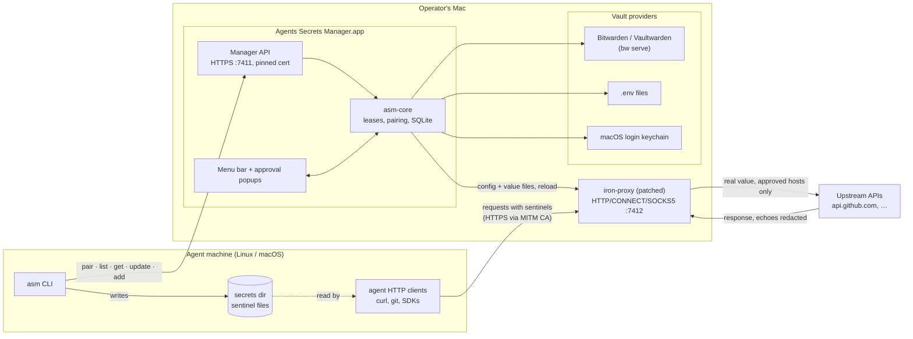

<!-- Logo: docs/assets/logotype.png goes here, e.g.
<p align="center"></p>
-->

# Agents Secrets Manager (asm)

[](https://github.com/Thinkscape/asm/actions/workflows/ci.yml)
[](https://github.com/Thinkscape/asm/releases/latest)

Coding agents need API keys and passwords. asm lets them ask for these without the real values ending up in prompts, logs or files on the agent machine:

- a **macOS menu-bar app** (the *manager*) reads secrets from your vaults (Bitwarden/Vaultwarden, `.env` files, the macOS login keychain) and shows an approval popup for every request;
- the **`asm` CLI** runs on agent machines (Linux or macOS), pairs with the manager and requests secrets;
- a **patched [iron-proxy](https://github.com/paradigmxyz/iron-proxy)**, run by the manager, puts the real value into requests on the way out;
- an **agent skill** ([`skill/asm/SKILL.md`](skill/asm/SKILL.md)) teaches agents the workflow.

By default the agent gets a **sentinel** (`asm_` + 40 random characters) instead of the value. The proxy replaces the sentinel with the real value only on HTTPS requests to the hosts you approved.

## Security model

- **A sentinel is a bearer capability.** The proxy has no authentication, so anyone who can reach the proxy and knows a sentinel can use it, but only with the hosts approved for that lease and only until the lease ends. Keep the proxy on a trusted network (LAN, Tailscale).
- **Bound to approved hosts and HTTPS.** A sentinel is replaced only when the destination matches the approved host patterns and the request uses TLS. A request that carries a sentinel in a header, the URL path or the query string to any other host, or over plain HTTP, is refused with `403 asm: sentinel not valid for this host or scheme`. Sentinels are never replaced in WebSocket upgrades, because the proxy cannot redact WebSocket frames (403).
- **Redaction is best effort.** If an upstream response echoes a real value (raw, URL-escaped, JSON-escaped, base64 or hex), the proxy replaces it with the sentinel in headers, trailers and the body. Values of other leases become `asm_redacted`. Values shorter than 8 bytes are not redacted. A host you approved can still return the value in some other form. Approving "Any host" amounts to giving the agent the value.
- **Raw values are opt-in per request.** `asm get --raw` asks for the real value. It is written to a file on the agent machine, cannot be recalled, and is never stored on the Mac.
- **Same-user processes on the Mac can read vault data.** Run agents as another user, in a VM or in a container.

## Architecture



1. `asm pair` pairs a machine with the manager: a matching 6-digit code on both sides, or a pre-generated pairing code. The CLI pins the manager's TLS certificate.
2. `asm get NAME "reason"` creates a request. The popup on the Mac shows the host, the agent, the reason and the requested hosts. You approve it with a sentinel (choosing the allowed hosts and the duration), approve it with the raw value, or deny it with a reason.
3. The CLI writes one file per field to the secrets directory and prints the paths.
4. Agent HTTP clients use the proxy (`eval "$(asm proxy-env)"`). The proxy terminates TLS with its own CA, replaces sentinels for approved hosts and redacts echoes in responses.

Default ports (changeable in the app): manager API `7411`, proxy `7412`, iron-proxy's internal loopback listeners `7413`–`7416`.

## Install

Release assets are on [GitHub Releases](https://github.com/Thinkscape/asm/releases/latest). Every release has a `SHA256SUMS` file.

### CLI with Homebrew (macOS, Linux)

```sh
brew install thinkscape/asm/asm
```

This taps [`Thinkscape/homebrew-asm`](https://github.com/Thinkscape/homebrew-asm) and installs the prebuilt binary (universal on macOS, x86_64 or arm64 on Linux). The agent skill is installed to `$(brew --prefix)/opt/asm/share/asm/skill/asm/SKILL.md`. Newer Homebrew versions require third-party taps to be trusted: the fully qualified name above trusts the formula. If you prefer `brew tap thinkscape/asm && brew install asm`, run `brew trust thinkscape/asm` first.

### CLI with an install script (macOS, Linux)

```sh
curl -fsSL https://raw.githubusercontent.com/Thinkscape/asm/main/scripts/install.sh | sh
```

The script detects the OS and architecture, downloads the matching tarball from the latest release, checks it against `SHA256SUMS` and installs `asm` to `~/.local/bin`. The skill goes to `~/.local/share/asm/skill/asm/SKILL.md`. Set `PREFIX=/usr/local` (with `sudo sh`) to install system-wide, or `ASM_VERSION=v0.1.0` to pin a release.

### CLI as a Linux package

The Linux binaries are static (musl), so the same package works on any distribution version. Packages install `/usr/bin/asm` and the skill at `/usr/share/asm/skill/asm/SKILL.md`. Use `x86_64` or `aarch64` in the file name to match `uname -m`:

```sh
base=https://github.com/Thinkscape/asm/releases/latest/download

# Debian, Ubuntu
curl -fsSLO $base/asm-linux-x86_64.deb && sudo apt install ./asm-linux-x86_64.deb

# Fedora, RHEL, openSUSE (dnf/zypper accept unsigned local packages; plain `rpm -i` on rpm 6 needs --nosignature)
sudo dnf install $base/asm-linux-x86_64.rpm

# Alpine
wget $base/asm-linux-x86_64.apk && sudo apk add --allow-untrusted ./asm-linux-x86_64.apk

# Arch Linux
sudo pacman -U $base/asm-linux-x86_64.pkg.tar.zst
```

**Why there is no apt/yum repository yet:** a package repository is only useful if it is signed. An unsigned apt repository needs `[trusted=yes]` and an unsigned yum repository needs `gpgcheck=0`. Both settings make the package manager accept anything served from that URL on every future update. The packages are not GPG-signed either, which is why Alpine needs `--allow-untrusted`. Until a signing key is set up for the project, install the packages from the release and check them against `SHA256SUMS`:

```sh
curl -fsSLO $base/SHA256SUMS && sha256sum --ignore-missing -c SHA256SUMS
```

### CLI from a tarball

```sh
curl -fsSLO https://github.com/Thinkscape/asm/releases/latest/download/asm-linux-x86_64.tar.gz
tar -xzf asm-linux-x86_64.tar.gz
install -m 0755 asm-linux-x86_64/asm ~/.local/bin/asm
```

Tarballs are `asm-linux-x86_64`, `asm-linux-aarch64` and `asm-macos-universal`. Each contains `asm`, `README.md`, `LICENSE` and `skill/asm/SKILL.md`.

### The manager app (macOS 14 or later)

```sh
brew install --cask thinkscape/asm/asm-manager
```

You can also download `Agents-Secrets-Manager-macos.zip` from the release, unzip it and move **Agents Secrets Manager.app** to `/Applications`. Release builds are not notarized. If macOS refuses to open the app, allow it in **System Settings → Privacy & Security**, or run `xattr -dr com.apple.quarantine "/Applications/Agents Secrets Manager.app"`. On the first launch, allow incoming connections for the app and for `iron-proxy` if remote agent machines will connect.

The app lives in the menu bar (key icon) and has no Dock icon.

## Getting started

On the Mac:

1. Open **Agents Secrets Manager** and choose **Settings…** from the menu bar item.
2. In **Vaults**, add a vault: **Bitwarden…**, **.env file…** or **macOS Keychain**.
3. In **Proxy**, add hostname hints that agent machines can reach (for example a Tailscale name). `asm proxy-info` offers these to clients.

On the agent machine:

```sh
asm pair my-mac.tailnet.ts.net
# verification code: 123 456
# … approve the pairing popup on the Mac after checking the code matches …
# paired: 6f1c…

asm doctor                  # every line should say ok
eval "$(asm proxy-env)"     # HTTPS_PROXY, CA bundle variables, NO_PROXY for the manager
asm list
asm get --hosts api.github.com GITHUB_TOKEN "Open a PR on acme/web for the login fix; needs the GitHub API"
# mode: sentinel
# hosts: api.github.com
# expires: 2026-11-16T12:34:56Z
# /run/user/1000/asm/secrets/GITHUB_TOKEN

curl -H "Authorization: Bearer $(cat /run/user/1000/asm/secrets/GITHUB_TOKEN)" https://api.github.com/user
```

To pair without a popup (scripts, containers), use **Hosts and Agents → Pairing codes → Generate…** in the app. It shows a ready-to-run command:

```sh
asm pair my-mac.tailnet.ts.net:7411 asm-<secret>-<fingerprint>   # or set ASM_PAIRING_CODE
```

A pairing code has a label, an expiry, a maximum number of uses and optionally the networks it may be used from. The fingerprint part makes the CLI refuse a manager whose certificate does not match before it sends the secret.

To teach an agent the workflow, give it the skill at [`skill/asm/SKILL.md`](skill/asm/SKILL.md) (also installed by every package; see above).

## CLI reference

```text
Usage: asm <COMMAND>

Commands:
  pair        Pair this machine with a manager (default port 7411)
  list        List the secrets you can request
  get         Request a lease on a secret and write its files
  update      Change a secret; the new value is read from stdin
  add         Add a new secret; the value is read from stdin
  proxy-info  Show the proxy addresses, which one is reachable, and the CA files (information only)
  proxy-env   Print shell code that points HTTP clients at the proxy: eval "$(asm proxy-env)". Prints nothing on stdout (and exits 1) when no proxy address is reachable
  doctor      Check pairing, connectivity, files and the proxy
```

|Command|Options|Notes|
|---|---|---|
|`asm pair <MANAGER> [PAIRING_CODE]`||`MANAGER` is `<hostname>[:port]`. `PAIRING_CODE` (`asm-…`) is the unattended code; it is also read from `$ASM_PAIRING_CODE`. Without a code the CLI prints `verification code: 123 456` and waits for approval. Prints `paired: <host id>`.|
|`asm list`|`--json`: print the manager's JSON answer|One name per line. Names are vault-prefixed (`work/GITHUB_TOKEN`) when two vaults share a name.|
|`asm get <NAME> <REASON>`|`--raw`: ask for the real value instead of a sentinel<br>`--hosts <HOSTS>`: hosts the sentinel will be used with (comma-separated patterns)<br>`--wait <WAIT>`: stop waiting after this many seconds (exit 4 while still pending); default: until the request expires on the manager (typically 10 min)<br>`--json`: print the result as JSON|`REASON` is shown to the operator (at most 250 characters). Prints `mode:`, `hosts:` (as approved, which may differ from the request), `expires:` and one absolute file path per field. A repeated sentinel `get` covered by an active lease returns without a popup.|
|`asm update <NAME>`|`--field <FIELD>`: field to change (default: `password` for logins, the only field otherwise)<br>`--wait <WAIT>`|Reads the new value from stdin. Prints `updated <name> in <vault>`. Raw leases on that secret are revoked.|
|`asm add <NAME>`|`--wait <WAIT>`|Reads the value from stdin. The operator picks the vault. Prints `added <name> to <vault>; run asm get to use it`.|
|`asm proxy-info`|`--json`|Proxy URLs (`http://` and `socks5h://` per hostname hint, the first reachable one marked `(recommended)`), CA certificate and CA bundle paths. Refreshes the CA files.|
|`asm proxy-env`|`--shell <posix\|fish>`: output syntax (default `posix`)<br>`--unset`: print code that removes the variables instead|Sets `HTTPS_PROXY`, `HTTP_PROXY`, `ALL_PROXY`, `NO_PROXY` (the manager host), `SSL_CERT_FILE`, `REQUESTS_CA_BUNDLE`, `CURL_CA_BUNDLE`, `GIT_SSL_CAINFO` (system roots + proxy CA) and `NODE_EXTRA_CA_CERTS` (proxy CA).|
|`asm doctor`|`--probe-url <PROBE_URL>`: HTTPS URL fetched through the proxy (default `https://example.com/`)|One `ok` / `warn` / `FAIL` line per check: pairing, manager reachable and pin matches, token accepted, secrets directory, CA files, proxy addresses, an HTTPS request through the proxy.|

Host patterns follow iron-proxy's rules: case-insensitive, `*` matches any host, `*.example.com` matches `example.com` and every subdomain, and any other `*` is a glob. Patterns have no scheme and no port.

Exit codes:

|Code|Meaning|
|---|---|
|0|ok|
|1|connection or other failure, vault unavailable, rate limited, request lost (manager restarted)|
|2|invalid input|
|3|denied (`denied: <reason>` on stderr) or expired|
|4|still pending when `--wait` elapsed; run the same command again to keep waiting|
|5|not found, ambiguous name, or (`add`) a secret with that name already exists|
|6|not paired, or the manager rejected this host's token|

Files on the agent machine:

|Path|Contents|
|---|---|
|`${XDG_CONFIG_HOME:-~/.config}/asm/host.json`|manager URL, pinned certificate, host token (mode 0600)|
|`${XDG_CONFIG_HOME:-~/.config}/asm/ca.crt`, `ca-bundle.crt`|proxy CA, and system roots plus the proxy CA|
|`$ASM_SECRETS_DIR`, else `$XDG_RUNTIME_DIR/asm/secrets`, else `~/.asm/secrets`|lease files (0600); deleted when leases expire or are revoked|

Environment: `ASM_PAIRING_CODE` (unattended pairing), `ASM_SECRETS_DIR` (secrets directory), and `ASM_AGENT` (agent label shown to the operator; defaults to the CLI's parent process name).

## The manager app

- **Menu bar**: pending requests (click one to open its approval popup), recent decisions, locked vaults to unlock, **Settings…**, **Show Log…** and **Quit**.
- **Approval popup**: one request at a time, floating above other windows and excluded from screen sharing. Pairing requests show the verification code. `get` requests show the reason, the requested mode, an editable list of allowed hosts (broad patterns flagged), an **Any host** toggle and the lease duration. Use **Approve and hide value** (sentinel) or **Approve and show raw value**. **Deny** is a split button with canned reasons: *host selection too open*, *provide a better reason*, or a custom one.
- **Settings window**:
  - **Vaults**: Bitwarden/Vaultwarden (server, API key, exposed collections, personal vault; master password held in memory only), `.env` files (every key is exposed), the macOS login keychain (generic and internet passwords, secure notes).
  - **Hosts and Agents**: paired machines (OS, addresses, agents seen, active leases), renaming and revocation; pairing codes.
  - **Leases**: active and ended leases with host, source, secret, mode, allowed hosts and expiry; search and revocation.
  - **Proxy**: status, health and CA expiry; listener address and port; hostname hints; advanced ports, request body limit and plain-HTTP substitution (off by default); the CA certificate; the proxy log.
  - **Settings**: manager API address and port, default lease duration, pending request lifetime, launch at login, the `bw` path, version.
- **Activity Log** (Window ▸ Show Activity Log, ⌘L): a persistent audit trail of pairing, requests, leases, proxy substitutions and vault events, filterable by category.

Data lives in `~/Library/Application Support/asm/`. Vault credentials are kept in the login keychain under the service `net.thinkscape.asm`.

## Building from source

Requirements: macOS with Xcode 27 (Swift 6.x, macOS 27 SDK), Rust (the version in [`rust-toolchain.toml`](rust-toolchain.toml) is installed automatically by rustup), Go matching [`third_party/iron-proxy/go.mod`](third_party/iron-proxy/go.mod) (`GOTOOLCHAIN=auto` fetches it), [zig](https://ziglang.org) and [just](https://just.systems).

```sh
just setup     # once: cargo-zigbuild and the Linux musl targets
just dist      # proxy + core + app + CLI + skill → dist/
just test      # cargo test --workspace, and go test for the patched iron-proxy
```

Individual recipes: `just proxy` (universal `dist/bin/iron-proxy`), `just core` (Rust static library, Swift bindings, xcframework), `just app` (signed `dist/Agents Secrets Manager.app`; set `ASM_CODESIGN_IDENTITY`, or `-` for ad hoc signing), `just cli` (`dist/cli/asm-linux-x86_64`, `asm-linux-aarch64`, `asm-macos-universal`), `just packages` (release tarballs, `.deb`/`.rpm`/`.apk`/Arch packages and `SHA256SUMS` in `dist/release`; needs [nfpm](https://nfpm.goreleaser.com)), `just install-cli`, `just install-cli-remote <ssh-host>`, `just lint-ci` (actionlint and shellcheck).

The headless end-to-end test (`crates/asm-core/tests/e2e.rs`) needs `dist/bin/iron-proxy` and skips itself without it. Tests that touch the real login keychain or a real `bw` are `#[ignore]`d; run them with `cargo test -p asm-core -- --ignored`.

### Releases

Pushing a tag `vX.Y.Z` (matching the version in `Cargo.toml` and `app/Bundle/Info.plist`) runs [`.github/workflows/release.yml`](.github/workflows/release.yml), which:

- builds the static Linux CLIs (x86_64, aarch64) and the universal macOS CLI, as tarballs and `.deb`/`.rpm`/`.apk`/Arch packages;
- builds the app on the `xcode-27` runner, signed with the `APPLE_CERT_P12` certificate if that secret is set and ad hoc otherwise, and zips it. This job is allowed to fail: the release then ships without the app;
- publishes a GitHub release with `SHA256SUMS`;
- updates `Formula/asm.rb` and `Casks/asm-manager.rb` in `Thinkscape/homebrew-asm` when the `HOMEBREW_TAP_DEPLOY_KEY` secret (a write deploy key on the tap) is set (stable tags only). The templates are in [`packaging/homebrew/`](packaging/homebrew/).

## Repository layout

|Path|What|
|---|---|
|`crates/asm-proto`|Wire types and shared rules (host patterns, names, pairing codes)|
|`crates/asm-core`|Manager core (macOS only): API server, pairing, requests, leases, vault providers, proxy supervisor; UniFFI exports|
|`crates/asm-cli`|The `asm` CLI|
|`crates/uniffi-bindgen-swift`|Swift binding generator used by `just core`|
|`app/`|SwiftUI menu-bar app (SwiftPM package)|
|`third_party/iron-proxy`|iron-proxy v0.56.0 (git subtree) with the asm patch|
|`skill/asm/SKILL.md`|Agent skill|
|`packaging/`|nfpm config, release packaging script, Homebrew formula and cask templates|
|`scripts/install.sh`|CLI install script|
|`.github/workflows`|CI and release|

## iron-proxy patch

`third_party/iron-proxy` is upstream [iron-proxy](https://github.com/paradigmxyz/iron-proxy) v0.56.0 (Apache-2.0, see its [LICENSE](third_party/iron-proxy/LICENSE)) with these changes to the `secrets` transform and the proxy pipeline:

- **Swap gate**: replace-mode values are substituted only when the host matches the entry's rules and the request arrived over TLS (or `allow_plain_http: true`). A sentinel in a header, the path or the query to any other host or scheme gets `403 asm: sentinel not valid for this host or scheme`, and so does a WebSocket upgrade that would carry a substituted value.
- **Response redaction**: echoes of substituted values (raw, query/path-escaped, JSON-escaped, base64, hex) in response headers, trailers and streamed bodies are replaced with the client's sentinel, and other entries' values with `asm_redacted`. A content-encoded response to a request that received a substitution is refused with 502. `Accept-Encoding` is removed from requests so the proxy decodes gzip itself, and `Range`/`If-Range` are removed when a value was substituted.
- **Fixes**: the second body secret of a request was never swapped (the body was not rewound), and bodies larger than `max_request_body_bytes` were forwarded truncated (now 413).

See the "Replace-mode safeguards (asm fork)" section of [`third_party/iron-proxy/README.md`](third_party/iron-proxy/README.md).

## License

[Apache-2.0](LICENSE). The bundled iron-proxy is Apache-2.0 as well.
