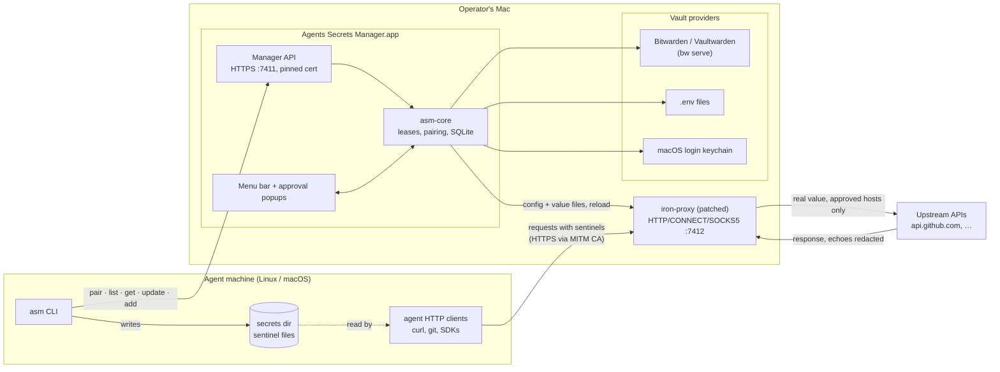

<p align="center">
  <picture>
    <source media="(prefers-color-scheme: dark)" srcset="docs/assets/logotype-dark.png">
    
  </picture>
</p>

# Agents Secrets Manager (asm)

[](https://github.com/Thinkscape/asm/actions/workflows/ci.yml)
[](https://github.com/Thinkscape/asm/releases/latest)

Coding agents need API keys and passwords. asm provides operator-approved access through static vaults and scoped dynamic credentials:

- a **macOS menu-bar app** (the *manager*) reads static vaults (Bitwarden/Vaultwarden, `.env` files, the macOS login keychain), generates GitHub App installation tokens, and approves access;
- the **`asm` CLI** runs on agent machines (Linux or macOS), pairs with the manager and requests secrets;
- a **patched [iron-proxy](https://github.com/paradigmxyz/iron-proxy)**, run by the manager, puts the real value into requests on the way out;
- an **agent skill** ([`skill/asm/SKILL.md`](skill/asm/SKILL.md)) teaches agents the workflow.

Static secrets default to **sentinel** delivery (`asm_` + 40 random characters): the proxy substitutes the real value only on approved HTTPS hosts. Generated GitHub tokens default to raw delivery, with optional `--sentinel`. `asm exec` injects approved values directly into a child environment without token files.

## Security model

- **A sentinel is a bearer capability.** The proxy has no authentication, so anyone who can reach the proxy and knows a sentinel can use it, but only with the hosts approved for that lease and only until the lease ends. Keep the proxy on a trusted network (LAN, Tailscale).
- **Bound to approved hosts and HTTPS.** A sentinel is replaced only when the destination matches the approved host patterns and the request uses TLS. A request that carries a sentinel in a header, the URL path or the query string to any other host, or over plain HTTP, is refused with `403 asm: sentinel not valid for this host or scheme`. Sentinels are never replaced in WebSocket upgrades, because the proxy cannot redact WebSocket frames (403).
- **Redaction is best effort.** If an upstream response echoes a real value (raw, URL-escaped, JSON-escaped, base64 or hex), the proxy replaces it with the sentinel in headers, trailers and the body. Values of other leases become `asm_redacted`. Values shorter than 8 bytes are not redacted. A host you approved can still return the value in some other form. Approving "Any host" amounts to giving the agent the value.
- **Raw delivery exposes the value to the consumer.** `get` writes private files; `exec` uses child memory/environment without credential files or argv. Generated GitHub tokens support provider revocation, but failed revocation or a manager crash can leave delivered copies usable until provider expiry. Static raw values cannot be recalled. Static raw requests require approval each time; generated raw leases allow reuse and renewal.
- **Same-user processes on the Mac can read vault data.** Run agents as another user, in a VM or in a container.
- **Host authorization, not agent isolation.** Pairing is the authorization boundary. Agent labels provide attribution and routing affinity; separate hostile agents need separate paired hosts.

## Architecture



1. `asm pair` pairs a machine with the manager: a matching 6-digit code on both sides, or a pre-generated pairing code. The CLI pins the manager's TLS certificate.
2. `asm get BINDING "reason"` or `asm exec BINDINGS -- command args...` requests access. Compatible leases may be reused; fresh approvals choose fields, mode, duration and hosts, plus the app/repositories/permissions for generated credentials.
3. Get writes files and prints paths; exec obtains all bindings before replacing itself with the child, passing argv directly without a shell. No credential values are printed by ASM.
4. Exec configures proxy/CA environment for substituted fields automatically. File-based sentinel consumers use `eval "$(asm proxy-env)"`.

Default ports (changeable in the app): manager API `7411`, proxy `7412`, iron-proxy's internal loopback listeners `7413`–`7416`.

## Install

Release assets are on [GitHub Releases](https://github.com/Thinkscape/asm/releases/latest). Every release has a `SHA256SUMS` file.

### CLI with Homebrew (macOS, Linux)

```sh
brew install thinkscape/asm/asm
asm skill install
```

This taps [`Thinkscape/homebrew-asm`](https://github.com/Thinkscape/homebrew-asm) and installs the prebuilt binary (universal on macOS, x86_64 or arm64 on Linux). Homebrew never writes to your home directory, so add the agent skill with `asm skill install` (see [The agent skill](#the-agent-skill)) and run it again after `brew upgrade`. A copy of the skill also stays at `$(brew --prefix)/opt/asm/share/asm/skill/asm/SKILL.md`. Newer Homebrew versions require third-party taps to be trusted: the fully qualified name above trusts the formula. If you prefer `brew tap thinkscape/asm && brew install asm`, run `brew trust thinkscape/asm` first.

### CLI with an install script (macOS, Linux)

```sh
curl -fsSL https://raw.githubusercontent.com/Thinkscape/asm/main/scripts/install.sh | sh
```

The script detects the OS and architecture, downloads the matching tarball from the latest release, checks it against `SHA256SUMS`, installs `asm` to `~/.local/bin` and then runs `asm skill install`, which adds the agent skill to `~/.agents/skills`. Set `PREFIX=/usr/local` (with `sudo sh`) to install system-wide, or `ASM_VERSION=v0.1.0` to pin a release. Under `sudo` the script skips the skill so that it does not land in root's home; run `asm skill install` as your own user afterwards. Running the script again upgrades both.

### CLI as a Linux package

The Linux binaries are static (musl), so the same package works on any distribution version. Packages install `/usr/bin/asm` and a copy of the skill at `/usr/share/asm/skill/asm/SKILL.md`; they do not touch home directories. Use `x86_64` or `aarch64` in the file name to match `uname -m`, then run `asm skill install` as each user whose agents need the skill:

```sh
base=https://github.com/Thinkscape/asm/releases/latest/download

# Debian, Ubuntu
curl -fsSLO $base/asm-linux-x86_64.deb && sudo apt install ./asm-linux-x86_64.deb

# Fedora, RHEL, openSUSE (dnf/zypper accept unsigned local packages; plain `rpm -i` on rpm 6 needs --nosignature)
sudo dnf install $base/asm-linux-x86_64.rpm

# Alpine
wget $base/asm-linux-x86_64.apk && sudo apk add --allow-untrusted ./asm-linux-x86_64.apk

# Arch Linux
sudo pacman -U $base/asm-linux-x86_64.pkg.tar.zst

# then, as your user
asm skill install
```

**Why there is no apt/yum repository yet:** a package repository is only useful if it is signed. An unsigned apt repository needs `[trusted=yes]` and an unsigned yum repository needs `gpgcheck=0`. Both settings make the package manager accept anything served from that URL on every future update. The packages are not GPG-signed either, which is why Alpine needs `--allow-untrusted`. Until a signing key is set up for the project, install the packages from the release and check them against `SHA256SUMS`:

```sh
curl -fsSLO $base/SHA256SUMS && sha256sum --ignore-missing -c SHA256SUMS
```

### CLI from a tarball

```sh
curl -fsSLO https://github.com/Thinkscape/asm/releases/latest/download/asm-linux-x86_64.tar.gz
tar -xzf asm-linux-x86_64.tar.gz
install -m 0755 asm-linux-x86_64/asm ~/.local/bin/asm
asm skill install
```

Tarballs are `asm-linux-x86_64`, `asm-linux-aarch64` and `asm-macos-universal`. Each contains `asm`, `README.md`, `LICENSE` and `skill/asm/SKILL.md`.

### The agent skill

The skill that teaches agents the asm workflow ([`skill/asm/SKILL.md`](skill/asm/SKILL.md)) is built into the `asm` binary, so the installed skill always matches the CLI version, however the CLI was installed:

```sh
asm skill install                                          # ~/.agents/skills/asm/SKILL.md
asm skill install --dir ~/.claude/skills --dir ~/.agents/skills   # several skill folders
asm skill status                                           # installed (current|outdated), foreign, symlink or missing
asm skill uninstall
```

`asm skill install` prints `installed: <path>`, `updated: <path>` (the skill text changed), `updated (asm-version only): <path>` (same text, installed by another `asm` version) or `up to date: <path>`; it writes nothing when the file already matches. Run it again after upgrading `asm`. The installed file records its origin at the end of the frontmatter, in the Agent Skills `metadata` map:

```yaml
metadata:
  installed-by: asm
  asm-version: "0.2.3"
```

asm only updates or removes files whose frontmatter has `installed-by: asm`. A `SKILL.md` you wrote yourself, or an `asm` folder that is a symlink (for example to the Homebrew copy), is refused with exit 1; `--force` replaces it with asm's copy (a symlink becomes a real folder; its target is not touched).

### The manager app (macOS 14 or later)

```sh
brew install --cask thinkscape/asm/asm-manager
```

You can also download `Agents-Secrets-Manager-macos.zip` from the release, unzip it and move **Agents Secrets Manager.app** to `/Applications`. Release builds are not notarized. If macOS refuses to open the app, allow it in **System Settings → Privacy & Security**, or run `xattr -dr com.apple.quarantine "/Applications/Agents Secrets Manager.app"`. On the first launch, allow incoming connections for the app and for `iron-proxy` if remote agent machines will connect.

The app lives in the menu bar (key icon) and has no Dock icon.

## Getting started

On the Mac:

1. Open **Agents Secrets Manager** and choose **Settings…** from the menu bar item.
2. In **Vaults**, add a static source, or in **Generators**, connect a GitHub App using its client ID, installation ID and RSA private key, then choose explicit repository and permission ceilings.
3. In **Proxy**, add hostname hints that agent machines can reach (for example a Tailscale name). `asm proxy-info` offers these to clients.

On the agent machine:

```sh
asm pair my-mac.tailnet.ts.net
# verification code: 123 456
# … approve the pairing popup on the Mac after checking the code matches …
# paired: 6f1c…

asm doctor
asm list --json
asm exec GH_TOKEN -- gh pr list --repo acme/web
# Approve the app, repository/permission grant, delivery mode and lease duration.
# Both GH_TOKEN and GITHUB_TOKEN are injected with the same value; no token files.

asm exec --sentinel --hosts api.github.com GITHUB_TOKEN -- gh api repos/acme/web
```

To pair without a popup (scripts, containers), use **Hosts and Agents → Pairing codes → Generate…** in the app. It shows a ready-to-run command:

```sh
asm pair my-mac.tailnet.ts.net:7411 asm-<secret>-<fingerprint>   # or set ASM_PAIRING_CODE
```

A pairing code has a label, an expiry, a maximum number of uses and optionally the networks it may be used from. The fingerprint part makes the CLI refuse a manager whose certificate does not match before it sends the secret.

#### Pairing the same machine again

- **While still paired.** `asm pair` checks whether the manager still accepts the stored pairing (`~/.config/asm/host.json`). If it does, the command prints `already paired with <manager> as <host id>; use --force to pair again` and exits 0.
- **Re-pairing.** When `host.json` belongs to the same manager certificate, the CLI sends its host id and token as proof. It never sends them to any other certificate. A proof the manager accepts keeps the **same host record**: the popup reads "Re-pair <name>", and a pairing code re-pairs without a popup. The host gets a new token and the old one stops working. Its info and addresses are refreshed, and its name, leases and history stay. The proof is used when `--force` was given or the token was rejected. A proof of a revoked host, or a wrong token, is ignored and the pairing is a new one.
- **Machine hint.** The CLI also sends a hash of the machine id: `/etc/machine-id` on Linux, the hardware UUID on macOS, nothing in a container that has none. Anyone can claim any value, so it is only a hint. If an interactive pairing without a valid proof matches an active host, the popup reads "Looks like <name> (paired <date>)" and offers **Replace <name>** (on by default). Replacing revokes the old host together with its leases, so no capability moves on the strength of the hint. The new host takes the old one's name. With the toggle off, the new host is a separate record. A pairing code never replaces a host by hint; the match is noted in the Activity Log.
- **Duplicates.** In **Hosts and Agents**, hosts that share a machine hint are flagged as possible duplicates. Revoke the stale one.

To teach an agent the workflow, install the skill with `asm skill install` (see [The agent skill](#the-agent-skill)).

### When a lease ends

A lease ends when it expires or the operator revokes it (also when its host is revoked, and raw leases when the secret is updated). Within about a second of that, the proxy answers any request that still carries the lease's sentinel, to any host, with `403` and the body `asm: sentinel expired or revoked; run asm get again`. Run `asm get` again for a new lease.

The lease files on the agent machine are deleted by the CLI: at expiry by a background `asm` process, and on revocation within about a minute.

Generated tokens have a separate provider deadline. A 12-hour lease can renew one-hour
tokens from the same app and immutable approved grant without extending authorization.
Raw token expiry removes file material but retains local alias reservations until the lease
ends. Repeat get to refresh file views; exec never updates them or renews a running child.
Routine renewal leaves old copies usable until natural expiry; explicit `--refresh` revokes
known predecessors and may disrupt consumers. `--lease ID` pins an existing generated grant;
`--new-lease` requests a fresh decision. After restart, generated grants remain but require
explicit acquisition to mint token material again.

Bindings use `[DEST=]SOURCE[::FIELD]`: for example
`asm get 'GOOGLE_USER=Vaultwarden/google::username' 'Sign in'`.
Exec takes comma-separated bindings and literal `--` before argv. Use single quotes to
preserve parser escapes (`\\`, `\,`, `\=`, `\:\:`); dots are literal. Multi-field exec
bindings require explicit destinations and selectors. See the
[agent workflow](skill/asm/SKILL.md) for scope, alias and collision examples.

## CLI reference

```text
Usage: asm <COMMAND>

Commands:
  pair        Pair this machine with a manager (default port 7411)
  list        List the secrets you can request
  get         Request a lease on a secret and write its files
  exec        Run a command with approved credentials in its environment
  update      Change a secret; the new value is read from stdin
  add         Add a new secret; the value is read from stdin
  proxy-info  Show the proxy addresses, which one is reachable, and the CA files (information only)
  proxy-env   Print shell code that points HTTP clients at the proxy: eval "$(asm proxy-env)". Prints nothing on stdout (and exits 1) when no proxy address is reachable
  doctor      Check pairing, connectivity, files and the proxy
  skill       Install the agent skill shipped with this CLI into agents' skill folders
```

|Command|Options|Notes|
|---|---|---|
|`asm pair <MANAGER> [PAIRING_CODE]`|`--force`: pair again although the current pairing still works|`MANAGER` is `<hostname>[:port]`. `PAIRING_CODE` (`asm-…`) is the unattended code; it is also read from `$ASM_PAIRING_CODE`. Without a code the CLI prints `verification code: 123 456` and waits for approval. Prints `paired: <host id>`, or `already paired with …` (exit 0) when the manager still accepts this machine's pairing. See [Pairing the same machine again](#pairing-the-same-machine-again).|
|`asm list`|`--json`: print the manager's JSON answer|One name per line. Names are vault-prefixed (`work/GITHUB_TOKEN`) when two vaults share a name.|
|`asm get <BINDING> <REASON>`|`--raw` / `--sentinel`, `--hosts`, `--wait`, `--json`, `--no-reaper`; generated grant and lease options in `asm get --help`|Prints paths and nonsecret lease/grant/version metadata. `[DEST=]SOURCE[::FIELD]` selects fields and local file views. Static raw requests always need approval.|
|`asm exec <BINDINGS> -- <COMMAND> [ARG...]`|`--raw` / `--sentinel`, `--hosts`, `--reason`, `--wait`|Sequential acquisitions share one wait deadline; any failure prevents launch. Discovery, proxy preparation and child runtime are outside that budget. No token files, reaper or in-process renewal.|
|`asm update <NAME>`|`--field <FIELD>`: field to change (default: `password` for logins, the only field otherwise)<br>`--wait <WAIT>`|Reads the new value from stdin. Prints `updated <name> in <vault>`. Raw leases on that secret are revoked.|
|`asm add <NAME>`|`--wait <WAIT>`|Reads the value from stdin. The operator picks the vault. Prints `added <name> to <vault>; run asm get to use it`.|
|`asm proxy-info`|`--json`|Proxy URLs (`http://` and `socks5h://` per hostname hint, the first reachable one marked `(recommended)`), CA certificate and CA bundle paths. Refreshes the CA files.|
|`asm proxy-env`|`--shell <posix\|fish>`: output syntax (default `posix`)<br>`--unset`: print code that removes the variables instead|Sets `HTTPS_PROXY`, `HTTP_PROXY`, `ALL_PROXY`, `NO_PROXY` (the manager host), `SSL_CERT_FILE`, `REQUESTS_CA_BUNDLE`, `CURL_CA_BUNDLE`, `GIT_SSL_CAINFO` (system roots + proxy CA) and `NODE_EXTRA_CA_CERTS` (proxy CA).|
|`asm doctor`|`--probe-url <PROBE_URL>`: HTTPS URL fetched through the proxy (default `https://example.com/`)|One `ok` / `warn` / `FAIL` line per check: pairing, manager reachable and pin matches, token accepted, secrets directory, CA files, proxy addresses, the manager's macOS Firewall (managers that report it), an HTTPS request through the proxy.|
|`asm skill install`|`--dir <DIR>` (repeatable; default `~/.agents/skills`)<br>`--force`: replace a skill not installed by asm, or an `asm` symlink<br>`--print`: print the embedded `SKILL.md` instead|Writes `<DIR>/asm/SKILL.md` (folders 0755, file 0644). Prints `installed: …`, `updated: …`, `updated (asm-version only): …` or `up to date: …` per folder; refusals go to stderr and make the exit code 1. See [The agent skill](#the-agent-skill).|
|`asm skill uninstall`|`--dir <DIR>` (repeatable)|Removes `<DIR>/asm/SKILL.md` only when asm installed it, then the `asm` folder when empty. Prints `removed: …`, `not installed: …` or `left alone (…): …`; exit 0.|
|`asm skill status`|`--dir <DIR>` (repeatable)<br>`--json`|One line per folder: `installed (current)` or `installed (outdated)` with the installed `asm-version`, `foreign`, `symlink` or `missing`. `--json` adds `installed_version` and this CLI's `version`. Exit 0.|

Host patterns follow iron-proxy's rules: case-insensitive, `*` matches any host, `*.example.com` matches `example.com` and every subdomain, and any other `*` is a glob. Patterns have no scheme and no port.

Exit codes:

|Code|Meaning|
|---|---|
|0|ok|
|1|connection or other failure, vault unavailable, rate limited, request lost (manager restarted)|
|2|invalid input|
|3|denied (`denied: <reason>` on stderr) or expired|
|4|still pending when `--wait` elapsed; run the same command again to keep waiting|
|5|not found, ambiguous name, or (`add`) a secret with that name already exists|
|6|not paired, or the manager rejected this host's token|

Files on the agent machine:

|Path|Contents|
|---|---|
|`${XDG_CONFIG_HOME:-~/.config}/asm/host.json`|manager URL, pinned certificate, host token (mode 0600)|
|`${XDG_CONFIG_HOME:-~/.config}/asm/ca.crt`, `ca-bundle.crt`|proxy CA, and system roots plus the proxy CA|
|`$ASM_SECRETS_DIR`, else `$XDG_RUNTIME_DIR/asm/secrets`, else `~/.asm/secrets`|lease files (0600); deleted when leases expire or are revoked (see below), plus the manifest `.leases.json` and the lock files `.leases.lock` and `.reaper.lock`|

File-based commands start one detached `asm reap` per secrets directory, held single by `.reaper.lock`. It removes material at lease expiry or raw generated-token expiry and polls revocations about once a minute. Generated token cleanup retains bindings/version reservations until authorization ends. `--no-reaper` or `ASM_NO_REAPER=1` leaves cleanup to later file-aware commands. File-free exec does not read/write secret manifests, clean secret files or start the reaper.

Environment: `ASM_PAIRING_CODE` (unattended pairing), `ASM_SECRETS_DIR` (secrets directory), `ASM_AGENT` (agent label shown to the operator; defaults to the CLI's parent process name), `ASM_NO_REAPER=1` (no background cleanup) and `ASM_REAPER_LOG` (a file the background cleanup logs to, for debugging).

## The manager app

- **Menu bar**: pending requests (click one to open its approval popup), recent decisions, locked vaults to unlock, **Settings…**, **Show Log…** and **Quit**. While the proxy is down (or running but not answering its health check for over 10 s) the icon gets a red dot and the panel a red banner with the cause, **Restart** and **Details…**. While the macOS Firewall blocks the proxy (or the manager API) and it listens for other machines, the icon gets the same red dot and the panel an orange banner with **Firewall Settings**, **How to Fix…** and **Details…**.
- **Approval popup**: one request at a time, floating above other windows and excluded from screen sharing. Pairing requests show the verification code. `get` requests show the reason, the requested mode, an editable list of allowed hosts (broad patterns flagged), an **Any host** toggle and the lease duration. Use **Approve and hide value** (sentinel) or **Approve and show raw value**. **Deny** is a split button with canned reasons: *host selection too open*, *provide a better reason*, or a custom one.
- **Settings window**:
  - **Vaults**: Bitwarden/Vaultwarden (server, API key, exposed collections, personal vault; master password held in memory only), `.env` files (every key is exposed), the macOS login keychain (generic and internet passwords, secure notes).
    The table sizes **Name** to the longest vault name (150pt minimum), keeps **Kind**, **Status** and **Secrets** compact, and gives **Details** the remaining width for the Bitwarden server URL or `.env` file path.
  - **Generators**: use **+** to choose a generator type (currently **GitHub App**). Configurations expose fixed `GH_TOKEN` / `GITHUB_TOKEN` aliases, installation discovery, explicit repository/permission ceilings and availability. Multiple apps share the logical output; approvals select one app.
  - **Hosts and Agents**: paired machines (OS, addresses, agents seen, active leases), renaming and revocation; pairing codes.
  - **Leases**: active and ended grants with host, source, mode, fields and hosts; generated details show the selected app, approved repositories/permissions, authorization deadline and provider-token deadline.
  - **Proxy**: status (running, starting, not running with the cause and since when, not responding), failed starts, health and CA expiry; network access (whether the proxy and the API listen for other machines, and what the macOS Firewall does to iron-proxy and the app); listener address and port; hostname hints; advanced ports, request body limit and plain-HTTP substitution (off by default); the CA certificate; the proxy log. The sidebar marks **Proxy** while it is down or blocked by the firewall.
  - **Settings**: manager API address and port, default lease duration, pending request lifetime, launch at login, the `bw` path, version.
- **Activity Log** (Window ▸ Show Activity Log, ⌘L): a persistent audit trail of pairing, requests, leases, proxy substitutions, vault and generator events, filterable by category. Generator events contain grant metadata and sanitized status, never keys or tokens.

Data lives in `~/Library/Application Support/asm/`. Vault credentials are kept in the login keychain under the service `net.thinkscape.asm`. One manager runs per data directory (`manager.lock`): a second copy shows an alert and quits.

## Troubleshooting

- **"Proxy is not running"** (red dot on the menu bar icon, banner in the panel, a macOS notification once per incident): agents' sentinels do not work until it runs again. The banner and **Settings → Proxy** show the cause, taken from iron-proxy's last error. The supervisor restarts it with backoff (1 s up to 30 s) and clears the alert once it answers its health check; the Activity Log records one `down` and one `recovered` row (with the downtime) per incident instead of every crash.
- **`port 7416 is in use by <name> (pid N)`**: another process listens on one of the proxy's ports (7412 tunnel, 7413–7416 internal). Stop it (`kill N`) or change the ports in **Settings → Proxy → Advanced**; the proxy recovers on its own. An iron-proxy left over from an earlier run of this app is killed automatically (Activity Log: `orphan_killed`).
- **Leftover iron-proxy processes**: the bundled iron-proxy exits within about a second when the app dies (`IRON_PARENT_PID` parent watch), and on start the app kills any iron-proxy started with this data directory's config. `pgrep -fl iron-proxy` lists them.
- **"Another Agents Secrets Manager is already running"**: quit the other copy (menu bar → **Quit**) first; check with `pgrep -fl AsmApp`.
- **Proxy health by hand**: `curl -s http://127.0.0.1:7416/healthz` prints `OK`; the full proxy log is `~/Library/Application Support/asm/logs/proxy.log`.
- **"macOS Firewall blocks iron-proxy"** (red dot, orange banner, a notification once per incident; `asm doctor` on agents prints `FAIL firewall`): agents connect over TCP, but every CONNECT is cut off before it reaches the proxy, and nothing shows in its log. Allow incoming connections for `iron-proxy` (and for Agents Secrets Manager) in **System Settings → Network → Firewall → Options**, or run the command **How to Fix…** shows: `sudo /usr/libexec/ApplicationFirewall/socketfilterfw --unblockapp "<path to iron-proxy>"`. The app only reads the firewall (`socketfilterfw --listapps`, no sudo) every 60 s, on wake and after listener changes; it never changes it. A proxy bound to `127.0.0.1` serves this Mac only and is never reported. No rule yet means macOS asks the first time another machine connects. The Activity Log records `firewall_blocked` / `firewall_allowed`.

## Building from source

Requirements: macOS with Xcode 27 (Swift 6.x, macOS 27 SDK), Rust (the version in [`rust-toolchain.toml`](rust-toolchain.toml) is installed automatically by rustup), Go matching [`third_party/iron-proxy/go.mod`](third_party/iron-proxy/go.mod) (`GOTOOLCHAIN=auto` fetches it), [zig](https://ziglang.org) and [just](https://just.systems).

```sh
just setup     # once: cargo-zigbuild and the Linux musl targets
just dist      # proxy + core + app + CLI + skill → dist/
just test      # cargo test --workspace, and go test for the patched iron-proxy
```

Individual recipes: `just proxy` (universal `dist/bin/iron-proxy`), `just core` (Rust static library, Swift bindings, xcframework), `just app` (signed `dist/Agents Secrets Manager.app`; set `ASM_CODESIGN_IDENTITY`, or `-` for ad hoc signing), `just cli` (`dist/cli/asm-linux-x86_64`, `asm-linux-aarch64`, `asm-macos-universal`), `just packages` (release tarballs, `.deb`/`.rpm`/`.apk`/Arch packages and `SHA256SUMS` in `dist/release`; needs [nfpm](https://nfpm.goreleaser.com)), `just install-cli`, `just install-cli-remote <ssh-host>`, `just lint-ci` (actionlint and shellcheck).

The headless end-to-end test (`crates/asm-core/tests/e2e.rs`) needs `dist/bin/iron-proxy` and skips itself without it. Tests that touch the real login keychain or a real `bw` are `#[ignore]`d; run them with `cargo test -p asm-core -- --ignored`.

Branding: edit the Signal source at `docs/assets/src/appicon.svg`, then run `swift scripts/brand-assets.swift docs/assets/src/appicon.svg` from the repository root on macOS. AppKit loads the SVG natively; the script writes `app/Bundle/AppIcon.icns`, `docs/assets/icon.png`, `docs/assets/logotype.png` and `docs/assets/logotype-dark.png`. The menu-bar glyph stays monochrome.

### Releases

Pushing a tag `vX.Y.Z` (matching the version in `Cargo.toml` and `app/Bundle/Info.plist`) runs [`.github/workflows/release.yml`](.github/workflows/release.yml), which:

- builds the static Linux CLIs (x86_64, aarch64) and the universal macOS CLI, as tarballs and `.deb`/`.rpm`/`.apk`/Arch packages;
- builds the app on the `xcode-27` runner, signed with the `APPLE_CERT_P12` certificate if that secret is set and ad hoc otherwise, and zips it. This job is allowed to fail: the release then ships without the app;
- publishes a GitHub release with `SHA256SUMS`;
- updates `Formula/asm.rb` and `Casks/asm-manager.rb` in `Thinkscape/homebrew-asm` when the `HOMEBREW_TAP_DEPLOY_KEY` secret (a write deploy key on the tap) is set (stable tags only). The templates are in [`packaging/homebrew/`](packaging/homebrew/).

## Repository layout

|Path|What|
|---|---|
|`crates/asm-proto`|Wire types and shared rules (host patterns, names, pairing codes)|
|`crates/asm-core`|Manager core (macOS only): API server, pairing, requests, leases, vault providers, proxy supervisor; UniFFI exports|
|`crates/asm-cli`|The `asm` CLI|
|`crates/uniffi-bindgen-swift`|Swift binding generator used by `just core`|
|`app/`|SwiftUI menu-bar app (SwiftPM package)|
|`third_party/iron-proxy`|iron-proxy v0.56.0 (git subtree) with the asm patch|
|`skill/asm/SKILL.md`|Agent skill|
|`packaging/`|nfpm config, release packaging script, Homebrew formula and cask templates|
|`scripts/install.sh`|CLI install script|
|`.github/workflows`|CI and release|

## iron-proxy patch

`third_party/iron-proxy` is upstream [iron-proxy](https://github.com/paradigmxyz/iron-proxy) v0.56.0 (Apache-2.0, see its [LICENSE](third_party/iron-proxy/LICENSE)) with these changes to the `secrets` transform and the proxy pipeline:

- **Swap gate**: replace-mode values are substituted only when the host matches the entry's rules and the request arrived over TLS (or `allow_plain_http: true`). A sentinel in a header, the path or the query to any other host or scheme gets `403 asm: sentinel not valid for this host or scheme`, and so does a WebSocket upgrade that would carry a substituted value.
- **Ended sentinels**: a `replace` entry with `ended: true` (no source or rules) never substitutes; a request carrying its sentinel in a header, the path or the query gets `403 asm: sentinel expired or revoked; run asm get again`.
- **Response redaction**: echoes of substituted values (raw, query/path-escaped, JSON-escaped, base64, hex) in response headers, trailers and streamed bodies are replaced with the client's sentinel, and other entries' values with `asm_redacted`. A content-encoded response to a request that received a substitution is refused with 502. `Accept-Encoding` is removed from requests so the proxy decodes gzip itself, and `Range`/`If-Range` are removed when a value was substituted.
- **Fixes**: the second body secret of a request was never swapped (the body was not rewound), and bodies larger than `max_request_body_bytes` were forwarded truncated (now 413).
- **Supervision**: with `IRON_PARENT_PID=<pid>` the proxy shuts down (1 s grace) when that process exits (kqueue `NOTE_EXIT` on macOS, `getppid` polling elsewhere), and a fatal error ends it with exit status 1 instead of 0.

See the "Replace-mode safeguards (asm fork)" section of [`third_party/iron-proxy/README.md`](third_party/iron-proxy/README.md).

## License

[Apache-2.0](LICENSE). The bundled iron-proxy is Apache-2.0 as well.
