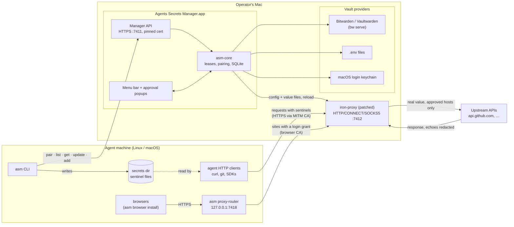

<p align="center">
  <picture>
    <source media="(prefers-color-scheme: dark)" srcset="docs/assets/logotype-dark.png">
    
  </picture>
</p>

# Agents Secrets Manager (asm)

[](https://github.com/Thinkscape/asm/actions/workflows/ci.yml)
[](https://github.com/Thinkscape/asm/releases/latest)

Coding agents need API keys and passwords. asm provides operator-approved access through static vaults, scoped dynamic credentials and browser logins:

- a **macOS menu-bar app** (the *manager*) reads static vaults (Bitwarden/Vaultwarden, `.env` files, the macOS login keychain), issues GitHub App and Google service-account tokens, issues short-lived SSH certificates for enrolled hosts, and approves access;
- the **`asm` CLI** runs on agent machines (Linux or macOS), pairs with the manager, requests secrets and SSH access, and sets up browsers for logins;
- a **patched [iron-proxy](https://github.com/paradigmxyz/iron-proxy)**, run by the manager, puts the real value into requests on the way out;
- an **agent skill** ([`skill/asm/SKILL.md`](skill/asm/SKILL.md), with a setup and troubleshooting guide, [`SETUP.md`](skill/asm/SETUP.md)) teaches agents the workflow.

Static secrets default to **sentinel** delivery (`asm_` + 40 random characters): the proxy substitutes the real value only on approved HTTPS hosts. New GitHub App and Google Cloud token grants are **raw only**. `asm exec` injects them directly into the child environment without token files or ASM proxy setup.

**Browser logins** let an agent sign in to a website in the browser it drives, without the password reaching the model or the browser's machine:

- **Login grants**: `asm get --login-url URL` gives, on one approval, the username, a single-use password sentinel and the current one-time code. The proxy substitutes the password only in a post to exactly that HTTPS URL, which also covers JavaScript sign-ins that post to an API (Clerk and similar).
- **One-time codes**: Bitwarden/Vaultwarden logins with an authenticator key get a `totp` field; the key never leaves the manager. While a login grant lasts, `asm get ITEM::totp` returns fresh codes without a popup.
- **Browser setup**: `asm browser install chrome|t3code|openbot` covers Chrome and Chromium profiles, T3 Code preview tabs and OpenBot's browser sessions. A local proxy router sends only HTTPS to a granted site through the manager's proxy; a dedicated browser CA is used only for those sites.
- **Login broker**: `asm login URL` covers sites where a sentinel can't work. The manager fills the login in Chrome on the Mac, the operator signs in and hands the session (cookies, localStorage) to the agent.
- **Proxy authentication** (opt-in): each paired host gets its own proxy credentials; login grants then work only from the requesting machine.
- **Diagnostics**: `asm doctor` checks the router and each installed browser and prints a `fix:` command per failure; `SETUP.md` covers setup and troubleshooting per environment.

See [Browser logins](#browser-logins).

**GitHub CLI**: `asm gh install` puts a `gh` shim first on `PATH`, and `asm gh repo add OWNER/REPO` chooses the repositories. Plain `gh` commands, and tools that ask `gh auth token` (such as T3 Code's PR panel), then get a GitHub App token for exactly those repositories; the manager renews it without asking until the lease ends. See [GitHub CLI](#github-cli-asm-gh).

## Security model

- **A sentinel is a bearer capability.** By default the proxy has no authentication, so anyone who can reach the proxy and knows a sentinel can use it, but only with the hosts approved for that lease and only until the lease ends. Keep the proxy on a trusted network (LAN, Tailscale). **Settings → Proxy → Require proxy authentication** makes every paired host sign in to the proxy with its own credentials; login grants then only work from the machine that requested them.
- **Bound to approved hosts and HTTPS.** A sentinel is replaced only when the destination matches the approved host patterns and the request uses TLS. A request that carries a sentinel in a header, the URL path, the query string or a scanned body to any other host, or over plain HTTP, is refused with `403 asm: sentinel not valid for this host or scheme`. Sentinels are never replaced in WebSocket upgrades, because the proxy cannot redact WebSocket frames (403).
- **Browser logins trust a dedicated CA.** `asm browser install` adds the manager's browser CA to one browser or, with `--trust-user-wide` (OpenBot, and T3 Code on macOS), to the user's trust store. The proxy issues certificates from it only for the site of an active login grant, routed by that machine's `asm proxy-router`. Whoever holds the browser CA key on the Mac could impersonate any site to those browsers (with user-wide trust, to every app that uses the store), the same risk class as the proxy CA key. A site that echoes the field holding a login sentinel can return the password to the page; response redaction is best effort.
- **Redaction is best effort.** If an upstream response echoes a real value (raw, URL-escaped, JSON-escaped, base64 or hex), the proxy replaces it with the sentinel in headers, trailers and the body. Values of other leases become `asm_redacted`. Values shorter than 8 bytes are not redacted. A host you approved can still return the value in some other form. Approving "Any host" amounts to giving the agent the value.
- **Raw delivery exposes the value to the consumer.** `get` writes private files; `exec` uses child memory/environment without credential files or argv. Generated GitHub tokens support provider revocation, but failed revocation or a manager crash can leave delivered copies usable until provider expiry. Static raw values cannot be recalled. Static raw requests require approval each time; generated raw leases allow reuse and renewal.
- **Google tokens cannot be individually revoked.** Ending a lease stops ASM delivery and substitution. Copies remain usable until credential expiry. IAM grants may change outside ASM; the project and selected OAuth scopes are not an exclusive service or resource boundary.
- **Same-user processes on the Mac can read vault data.** Run agents as another user, in a VM or in a container.
- **`asm gh` grants are standing and host-wide.** After approval, an owner's GitHub token serves every `gh` call of that user on that machine until the lease ends, renewed without asking. Tokens are cached on a tmpfs for at most their provider lifetime. Revoking the lease stops renewal and revokes the known tokens at GitHub; a copy survives only where that revocation fails.
- **Host authorization, not agent isolation.** Pairing is the authorization boundary. Agent labels provide attribution and routing affinity; separate hostile agents need separate paired hosts.

## Architecture



1. `asm pair` pairs a machine with the manager: a matching 6-digit code on both sides, or a pre-generated pairing code. The CLI pins the manager's TLS certificate.
2. `asm get BINDING "reason"` or `asm exec BINDINGS -- command args...` requests access. Compatible leases may be reused; fresh approvals choose fields, mode, duration and hosts. Generated credentials also require an identity and grant: GitHub repositories and permissions, or Google OAuth scopes.
3. Get writes files and prints paths; exec obtains all bindings before replacing itself with the child, passing argv directly without a shell. No credential values are printed by ASM.
4. Exec configures proxy/CA environment for substituted fields automatically. File-based sentinel consumers use `eval "$(asm proxy-env)"`.
5. For [browser logins](#browser-logins), a browser set up with `asm browser install` sends its HTTPS to `asm proxy-router` on the same machine, which forwards only sites with an active login grant to the proxy.

Default ports (changeable in the app): manager API `7411`, proxy `7412`, iron-proxy's internal loopback listeners `7413`–`7416`. On machines set up with `asm browser install`, the proxy router listens on `127.0.0.1:7418`.

## Install

Release assets are on [GitHub Releases](https://github.com/Thinkscape/asm/releases/latest). Every release has a `SHA256SUMS` file.

You can upgrade the manager before paired CLIs. Versions v0.3.0–v0.5.0 can still discover generators; their legacy `available` field means the generator is listed, not that its provider is unlocked or ready. Upgrade the CLI for per-field delivery receipts and raw-only generated-token checks before submitting a request.

### CLI with Homebrew (macOS, Linux)

```sh
brew install thinkscape/asm/asm
asm skill install
```

This taps [`Thinkscape/homebrew-asm`](https://github.com/Thinkscape/homebrew-asm) and installs the prebuilt binary (universal on macOS, x86_64 or arm64 on Linux). Homebrew never writes to your home directory, so add the agent skill with `asm skill install` (see [The agent skill](#the-agent-skill)) and run it again after `brew upgrade`. A copy of the skill also stays at `$(brew --prefix)/opt/asm/share/asm/skill/asm/SKILL.md`. Newer Homebrew versions require third-party taps to be trusted: the fully qualified name above trusts the formula. If you prefer `brew tap thinkscape/asm && brew install asm`, run `brew trust thinkscape/asm` first.

### CLI with an install script (macOS, Linux)

```sh
curl -fsSL https://raw.githubusercontent.com/Thinkscape/asm/main/scripts/install.sh | sh
```

The script detects the OS and architecture, downloads the matching tarball from the latest release, checks it against `SHA256SUMS`, installs `asm` to `~/.local/bin` and then runs `asm skill install`, which adds the agent skill to `~/.agents/skills`. Set `PREFIX=/usr/local` (with `sudo sh`) to install system-wide, or `ASM_VERSION=v0.1.0` to pin a release. Under `sudo` the script skips the skill so that it does not land in root's home; run `asm skill install` as your own user afterwards. Running the script again upgrades both.

### CLI as a Linux package

The Linux binaries are static (musl), so the same package works on any distribution version. Packages install `/usr/bin/asm` and a copy of the skill in `/usr/share/asm/skill/asm/`; they do not touch home directories. Use `x86_64` or `aarch64` in the file name to match `uname -m`, then run `asm skill install` as each user whose agents need the skill:

```sh
base=https://github.com/Thinkscape/asm/releases/latest/download

# Debian, Ubuntu
curl -fsSLO $base/asm-linux-x86_64.deb && sudo apt install ./asm-linux-x86_64.deb

# Fedora, RHEL, openSUSE (dnf/zypper accept unsigned local packages; plain `rpm -i` on rpm 6 needs --nosignature)
sudo dnf install $base/asm-linux-x86_64.rpm

# Alpine
wget $base/asm-linux-x86_64.apk && sudo apk add --allow-untrusted ./asm-linux-x86_64.apk

# Arch Linux
sudo pacman -U $base/asm-linux-x86_64.pkg.tar.zst

# then, as your user
asm skill install
```

**Why there is no apt/yum repository yet:** a package repository is only useful if it is signed. An unsigned apt repository needs `[trusted=yes]` and an unsigned yum repository needs `gpgcheck=0`. Both settings make the package manager accept anything served from that URL on every future update. The packages are not GPG-signed either, which is why Alpine needs `--allow-untrusted`. Until a signing key is set up for the project, install the packages from the release and check them against `SHA256SUMS`:

```sh
curl -fsSLO $base/SHA256SUMS && sha256sum --ignore-missing -c SHA256SUMS
```

### CLI from a tarball

```sh
curl -fsSLO https://github.com/Thinkscape/asm/releases/latest/download/asm-linux-x86_64.tar.gz
tar -xzf asm-linux-x86_64.tar.gz
install -m 0755 asm-linux-x86_64/asm ~/.local/bin/asm
asm skill install
```

Tarballs are `asm-linux-x86_64`, `asm-linux-aarch64` and `asm-macos-universal`. Each contains `asm`, `README.md`, `LICENSE` and `skill/asm/` (`SKILL.md`, `SETUP.md`).

### The agent skill

The skill that teaches agents the asm workflow ([`skill/asm/SKILL.md`](skill/asm/SKILL.md)) and its setup and troubleshooting guide ([`skill/asm/SETUP.md`](skill/asm/SETUP.md): pairing, `asm browser install` per browser, the proxy router, `asm gh`, a symptom → fix table) are built into the `asm` binary, so the installed skill always matches the CLI version, however the CLI was installed:

```sh
asm skill install                                          # ~/.agents/skills/asm/SKILL.md and SETUP.md
asm skill install --dir ~/.claude/skills --dir ~/.agents/skills   # several skill folders
asm skill install --print-setup                            # print SETUP.md (--print: SKILL.md)
asm skill status                                           # installed (current|outdated), foreign, symlink or missing
asm skill uninstall
```

`asm skill install` prints `installed: <path>`, `updated: <path>` (the skill or guide text changed), `updated (asm-version only): <path>` (same text, installed by another `asm` version) or `up to date: <path>`; it writes nothing when both files already match. Run it again after upgrading `asm`. `SETUP.md` belongs to the asm-installed `SKILL.md` beside it and is written and removed with it. The installed `SKILL.md` records its origin at the end of the frontmatter, in the Agent Skills `metadata` map:

```yaml
metadata:
  installed-by: asm
  asm-version: "0.2.3"
```

asm only updates or removes files whose frontmatter has `installed-by: asm`. A `SKILL.md` you wrote yourself, or an `asm` folder that is a symlink (for example to the Homebrew copy), is refused with exit 1; `--force` replaces it with asm's copy (a symlink becomes a real folder; its target is not touched).

### The manager app (macOS 14 or later)

```sh
brew install --cask thinkscape/asm/asm-manager
```

You can also download `Agents-Secrets-Manager-macos.zip` from the release, unzip it and move **Agents Secrets Manager.app** to `/Applications`. Release builds are not notarized. If macOS refuses to open the app, allow it in **System Settings → Privacy & Security**, or run `xattr -dr com.apple.quarantine "/Applications/Agents Secrets Manager.app"`. On the first launch, allow incoming connections for the app and for `iron-proxy` if remote agent machines will connect.

The app lives in the menu bar (key icon) and has no Dock icon.

## Getting started

On the Mac:

1. Open **Agents Secrets Manager** and choose **Settings…** from the menu bar item.
2. In **Vaults**, add a static source. In **Generators**, choose **GitHub App** for repository/permission ceilings, or **Google Cloud** to connect a Google account. For Google, name the generator, check the manager Mac’s Cloud SDK (582.0.0 or later), sign in through the browser, and save. Saving does not change cloud IAM, require a project or service account, or import your normal CLI/ADC credentials.
3. In **Proxy**, add hostname hints that agent machines can reach (for example a Tailscale name). `asm proxy-info` offers these to clients.

On the agent machine:

```sh
asm pair my-mac.tailnet.ts.net
# verification code: 123 456
# … approve the pairing popup on the Mac after checking the code matches …
# paired: 6f1c…

asm doctor
asm list --json
asm exec --repositories acme/web --permissions pull_requests=read GH_TOKEN -- gh pr list --repo acme/web
# ASM uses the repo to select an installation; gh uses --repo to select the PR list.
# Both GH_TOKEN and GITHUB_TOKEN are injected with the same value; no token files.

# or, once per machine, make plain gh work through the manager:
asm gh install
asm gh repo add acme/web    # the operator approves; then: gh pr list --repo acme/web
```

For GitHub, `get` and `exec` require `--repositories OWNER/REPO[,OWNER/REPO...]` unless `get --lease ID` pins an existing grant. Permissions default to `metadata=read`; request additional access with `--permissions contents=read,pull_requests=write`. The popup marks what the agent requested. The operator can remove or add repositories and change permission levels within **one configured installation’s limits**. Installations cannot be combined in one token. Raw GitHub tokens need no proxy.

For a Google Cloud connection, request **one project and the permissions you need**. `get` writes the approved token to a private file; `exec` injects `CLOUDSDK_AUTH_ACCESS_TOKEN` into the child without writing a token file:

```sh
asm get --project my-staging-project --permissions storage=read \
  CLOUDSDK_AUTH_ACCESS_TOKEN 'Read objects in the staging project'
asm exec --project my-staging-project --permissions compute=read \
  CLOUDSDK_AUTH_ACCESS_TOKEN -- gcloud compute instances list --project=my-staging-project
```

The first `--project` describes the requested grant; the argument after `--` tells the consumer which resources to query. The supported claims are `storage=read`, `storage=create`, `compute=read`, `run=read`, `logs=read`, and `bigquery=metadata-read`. Use a comma-separated list for a combination; arbitrary IAM role names, OAuth scopes, and wildcard claims are not accepted for a connection. A role on the **project** is not a restriction to one bucket or resource.

The Google popup preselects the requested project and marks the requested access in each service’s permission menu. Storage read and create can be granted independently or together. With a compatible client, the operator can check another active project visible to the signed-in connection. This **switches** the grant to that project; it does not add a second project or rewrite the command after `--`. If the list cannot be loaded, the requested project remains available. As on GitHub, **Generate token** approves the current selection directly. Pinned renewals keep the approved grant.

**First use:** expand **IAM changes on approval** to see the proposed keyless service account, its project-level roles, and who can mint tokens. **Generate token** authorizes those durable changes and the lease. **Deny** makes no changes and delivers nothing. The administrator needs sufficient Google permissions. If setup succeeds but issuance fails, the cloud resources may remain; ASM reports the failure rather than substituting another credential. Later approvals for the same profile do not recreate it.

The agent receives a short-lived token for the profile's service account, never your sign-in token. IAM inheritance and changes outside ASM can affect effective access. A Google token is not itself restricted to a project. Ending a lease stops ASM delivery but does not revoke a released Google token, delete the account, or undo IAM bindings.

To decommission an ASM-created account, open **Settings → Generators → Google Service Accounts**. The tab bar appears when a Google Cloud generator is configured or the local provisioning journal contains an account record. Removing the last generator does not hide its recorded accounts. Select a row to see the immutable Google account ID, project, permissions and dependent leases, or open the account directly in Google Cloud Console. ASM will not delete an account by name alone.

**Delete Account** requires a separate confirmation. It removes all local leases for that Google identity, including ended leases, and deletes the account in Google Cloud. Other workloads using that account can also lose access. If cloud cleanup fails, the leases are not restored: review the error and retry the same account from the ledger. Removing a generator is different: it does not delete its cloud accounts.

Existing generators bound to a service account remain separate legacy configurations; an existing lease does not gain managed-profile issuance rights. `--gcloud-scope` is for that legacy workflow, not an alternative to managed `--project` and `--permissions`. Paired hosts do not need gcloud to acquire credentials. `GOOGLE_APPLICATION_CREDENTIALS` expects a credential file, not the bearer token.

To pair without a popup (scripts, containers), use **Hosts and Agents → Pairing codes → Generate…** in the app. It shows a ready-to-run command:

```sh
asm pair my-mac.tailnet.ts.net:7411 asm-<secret>-<fingerprint>   # or set ASM_PAIRING_CODE
```

A pairing code has a label, an expiry, a maximum number of uses and optionally the networks it may be used from. The fingerprint part makes the CLI refuse a manager whose certificate does not match before it sends the secret.

#### Pairing the same machine again

- **While still paired.** `asm pair` checks whether the manager still accepts the stored pairing (`~/.config/asm/host.json`). If it does, the command prints `already paired with <manager> as <host id>; use --force to pair again` and exits 0.
- **Re-pairing.** When `host.json` belongs to the same manager certificate, the CLI sends its host id and token as proof. It never sends them to any other certificate. A proof the manager accepts keeps the **same host record**: the popup reads "Re-pair <name>", and a pairing code re-pairs without a popup. The host gets a new token and the old one stops working. Its info and addresses are refreshed, and its name, leases and history stay. The proof is used when `--force` was given or the token was rejected. A proof of a revoked host, or a wrong token, is ignored and the pairing is a new one.
- **Machine hint.** The CLI also sends a hash of the machine id: `/etc/machine-id` on Linux, the hardware UUID on macOS, nothing in a container that has none. Anyone can claim any value, so it is only a hint. If an interactive pairing without a valid proof matches an active host, the popup reads "Looks like <name> (paired <date>)" and offers **Replace <name>** (on by default). Replacing revokes the old host together with its leases, so no capability moves on the strength of the hint. The new host takes the old one's name. With the toggle off, the new host is a separate record. A pairing code never replaces a host by hint; the match is noted in the Activity Log.
- **Duplicates.** In **Hosts and Agents**, hosts that share a machine hint are flagged as possible duplicates. Revoke the stale one.

To teach an agent the workflow, install the skill with `asm skill install` (see [The agent skill](#the-agent-skill)).

### Browser logins

Agents can sign in to websites in the browsers they drive (the user's Chrome, T3 Code preview tabs, OpenBot's browser sessions) with a vault login, without the password reaching the model or the browser's machine. Run the commands below on the machine where the browser runs. [`SETUP.md`](skill/asm/SETUP.md) has the exact steps per environment and a symptom → fix table.

#### Set up a browser

```sh
asm browser install chrome            # quit Chrome first; --profile NAME, or --user-data-dir DIR for other Chromium browsers
asm browser install t3code            # Linux; on macOS add --trust-user-wide
asm browser install openbot --trust-user-wide   # in a terminal: offers to quit and restart OpenBot
asm browser status
```

Every install saves the manager's **browser CA**, points the browser's HTTPS at `asm proxy-router` (`127.0.0.1:7418`) and installs that router as a user service (systemd user unit `asm-proxy-router.service` on Linux, LaunchAgent `com.thinkscape.asm.proxy-router` on macOS; with `--no-service`, run `asm proxy-router run` under your own supervisor).

- **chrome**: one profile of Chrome 134 or later, or of another Chromium user data directory. Restart the browser once afterwards.
- **t3code**: wraps every downloaded version of T3 Code's preview browser and applies the next time T3 starts it. Linux needs `certutil` (`libnss3-tools` / `nss-tools`); on macOS the CA goes into the login keychain. Run the install again when T3 downloads a newer browser.
- **openbot**: trusts the CA in the user's trust store and routes OpenBot's **Shared** and **agent-only** browser sessions, in every OpenBot server data directory on the machine. OpenBot must be stopped while asm writes the settings: in a terminal asm offers to quit and restart it (`--restart`: without asking), then confirms that the running OpenBot uses them. Run the install again for agents created later. Named browser profiles keep OpenBot's own proxy setting. Install where the OpenBot server runs, as its user; `SETUP.md` covers hosted servers and the alternatives (`--ca-only`, a systemd drop-in).

The router sends HTTPS for a site with an active login grant through the manager's proxy, which issues browser-CA certificates only for that site. All other HTTPS goes straight to the site, and plain HTTP never uses the router. While the router is down, HTTPS pages in a set-up browser fail rather than bypass it. Install refuses a browser that already uses another proxy. `asm browser status` and `asm doctor` report the router and each install, with a `fix:` command when one needs repeating. `asm browser uninstall <target>` restores the previous setting unless it changed since, and removes the router with the last install.

#### Sign in with a login grant

1. The agent finds the URL the login posts the password to: the form's `action`, or for a JavaScript sign-in the API request in the browser's network log (often on another host, such as Clerk's), query string included.
2. It runs `asm get --login-url <URL> [ITEM] --reason "…"`. The item defaults to the vault login whose URI matches the host. The command refuses, before the operator is asked, unless a browser on that machine sent the host through the router in the last 30 minutes (loading the login page does), so an unrouted browser can't waste an approval.
3. The operator approves one **sign-in**: Proxied only, 15 minutes by default, at most 1 hour.
4. The agent types the username and the password sentinel into the page and submits once. The proxy substitutes the real password only as a whole form or JSON value posted to exactly that URL; then the sentinel is spent.
5. When the item has an authenticator key, the grant includes the current one-time code, and `asm get ITEM::totp` returns fresh codes without a popup while the grant lasts.

#### Sign in on the Mac

Where a sentinel can't work (a password field with a short `maxlength`, one box per OTP digit), use `asm login <URL> [ITEM] --reason "…"`. After approval the manager opens Chrome on the Mac and fills the vault login (it never submits). The operator signs in and clicks **Hand over session**; the agent receives a Playwright storage state with the site's cookies and its origin's localStorage. For a site that signs in through a separate service host (Clerk, Auth0), add `--fill-origin https://<that host>` so that host's cookies come along.

### GitHub CLI (`asm gh`)

`asm gh` makes the real `gh` work through the manager, without `gh auth login`, a `GH_TOKEN` in your environment or `asm exec` around each command:

```sh
asm gh install                             # ~/.local/bin/gh: a shim, first on PATH
asm gh repo add AnswerShiftAI/platform     # the operator approves; repeat per repository
asm gh status
gh pr view 616 -R AnswerShiftAI/platform   # plain gh
```

- **The shim**: `asm gh install` writes `~/.local/bin/gh` (`--dir DIR` elsewhere), a two-line script that runs `asm gh shim` with the `asm` that installed it. The real `gh` stays where its package put it. Install checks that your login shell (`$SHELL -ilc 'command -v gh'`) finds the shim first. It refuses to replace a `gh` it did not write unless you pass `--force`, and never replaces a program; `asm gh uninstall` removes only its own script.
- **Repositories and permissions** are saved per owner (one GitHub App installation) in `~/.config/asm/gh.json`. One token covers all of an owner's repositories with one permission set: by default `actions`, `checks`, `contents`, `issues`, `metadata`, `pull_requests` and `statuses`, all read. `--permissions pull_requests=write` sets a level for all of that owner's repositories. Each `repo add` asks the operator at once to approve the owner's new set and saves it only after approval.
- **Requests**: the shim asks for the saved repositories and permissions exactly, as agent `asm-gh`, without broader lease reuse and without edits in the popup. The manager either renews the lease approved for exactly that set (silently until the lease ends) or asks the operator again; a shim request never receives another agent's broader lease. Choose a long lease duration in the popup: the manager's default is 1 hour.
- **Which commands get a token**: every command that talks to GitHub. Local commands (`--version`, `help`, `completion`, `config`, `alias`, `--help`, `auth` other than `token` and `status`) and any command run with `GH_TOKEN` or `GITHUB_TOKEN` already set (`asm exec … GH_TOKEN -- gh …`) go to the real `gh` unchanged. With several owners, a command uses the owner it names (`-R`/`--repo`, `GH_REPO`, `repo … OWNER/REPO`, `api repos/OWNER/…`, a github.com URL), else the owner of the current directory's `upstream`, `github` or `origin` remote, else the default owner (the first one added, or `repo add --default`).
- **Waiting**: `gh auth token` prints the default owner's token (`--user OWNER` picks another configured owner) and never waits: while an approval is pending it exits 4 at once. `gh auth status` runs the real `gh` with that token when one is available. Other commands wait up to 120 s for an approval (`ASM_GH_WAIT=<seconds>`; `0` does not wait). After a denial the shim stops asking for that owner for an hour, or until the next `asm gh repo add`.
- **Cache**: tokens are cached per owner in `$XDG_RUNTIME_DIR/asm/gh/` (mode 0600, only when that directory is a tmpfs). A cached token is used without asking the manager for a minute. After that the shim asks again and uses the cached token only while the manager is unreachable. A token with 7 minutes or less left is never handed out.
- **Who can use it**: like any lease of a paired host, the approved grant serves every process of this user on this machine, agents included. `gh` can write only where you approved write permissions; for anything else use `asm exec` with the permissions needed.
- **T3 Code**: T3's PR panel asks `gh auth token --hostname github.com`, so it works once the shim is installed and a repository added. T3 builds its `PATH` from your login shell, so `~/.local/bin` must come before the real `gh` there (`asm gh install` checks this). T3 keeps one token per host: its panel covers the default owner's repositories.
- **git** is not covered: `git fetch`/`git push` use git's own credential helper.

### When a lease ends

A lease ends when it expires or the operator revokes it (also when its host is revoked, and raw leases when the secret is updated). Within about a second of that, the proxy answers any request that still carries the lease's sentinel, to any host, with `403` and the body `asm: sentinel expired or revoked; run asm get again`. Run `asm get` again for a new lease.

The lease files on the agent machine are deleted by the CLI: at expiry by a background `asm` process, and on revocation within about a minute.

Generated tokens have a separate provider deadline. A 12-hour lease can renew one-hour
tokens from the same identity and immutable approved grant without extending authorization.
Raw token expiry removes file material but retains local alias reservations until the lease
ends. Repeat get to refresh file views; exec never updates them or renews a running child.
Routine renewal leaves old copies usable until natural expiry. Explicit `--refresh` rotates
the token; ASM can revoke known GitHub predecessors, not Google tokens. `--lease ID` pins an existing generated grant;
`--new-lease` requests a fresh decision.

**Automatic lease reuse.** GitHub and Google Cloud generators default to allowing broader matches. For an unpinned request, ASM looks for an active raw lease on the paired host for the requested output that covers **all** requested access. It prefers the latest lease expiration (no expiration wins), then the broadest grant, then the newest approval. For equal deadlines, GitHub breadth counts repositories times the sum of permission levels (read = 1, write = 2, admin = 3); Google breadth counts permission claims or legacy OAuth scopes.

For example, a request for `acme/web` with `contents=read` can immediately receive an existing token with `contents=write,pull_requests=write`, even if a different agent on the host obtained it. **The token retains its full grant**, including any extra repositories or permissions. Managed Google leases must cover the requested claims on the **same project**; legacy Google leases must contain every requested OAuth scope. ASM records broader deliveries in the Activity Log under **Generators** without prompting again.

Enable **Require exact scope match for lease reuse** in an individual generator’s settings to keep the previous behavior: ASM checks the newest relevant decision for the same agent and reuses it only if its issued scope matches exactly and the lease is still eligible. Older clients that do not negotiate broader reuse also use this behavior. `--lease ID` never silently substitutes a different lease, and `--new-lease` bypasses reuse entirely.

Identical GitHub token requests from the same paired host and agent share one pending
approval, lease and initial token. Each caller gets its own request ID and can collect
the raw result once, while the host, lease and token are still valid. Denying, cancelling
or expiring the pending approval ends it for all callers. After approval, cancelling one
ID discards only that caller’s delivery. A pending approval accepts up to 64 callers;
additional callers are rate-limited, not given a second approval.

**Restart is not revocation.** On relaunch, the manager restores unexpired generated tokens, their versions, approved sentinel mappings, and pending request IDs. It does not issue a new token, renew a deadline, or deny a pending request just because the process stopped. The API and proxy are unreachable while the manager is down. Explicit revocation, provider expiry, and changes to the configured authority still apply.
Previously issued generated sentinel leases keep their original mode, hosts and deadline. To use one explicitly, pin its lease ID. An unpinned request cannot reuse it; a new generated grant is always raw.

Restart records are encrypted in the manager database with a per-database key held in the Mac’s login Keychain. The database alone cannot recover the credentials. Interrupted operations that may already have written to an external provider must be reviewed; the manager does not automatically repeat those writes.

The first upgrade from a memory-only manager cannot recover credentials or pending requests the old process never saved. Let current work finish before quitting that version. Bitwarden restores a verified session key, never the master password; a rejected or unavailable key requires unlocking the vault again.

### SSH access

Agents can log in to SSH hosts without ever holding a reusable key. The manager keeps an SSH user CA in its encrypted restart storage, issues a per-lease Ed25519 key and certificate for each approval, and signs logins for the agent while the lease is active. The private key never leaves the Mac.

**Set up a host once (Settings → SSH Targets).**
1. Add a host:
   - its **host name** (`web.example.com`), which agents also use;
   - the **privileged login** your own ssh uses to enroll and remove;
   - whether to **Allow privileged access**;
   - the **other users** agents may log in as (**Choose Users…** lists the host's accounts);
   - the **log units** and **restart units** restricted leases may use;
   - the longest lease.

   The Mac's ssh destination and the address agents connect to default to the host name. Set them only for exceptions such as split DNS. The sheet takes the host keys from your `known_hosts` as you type; asm never writes to it. If it has no key for the destination (check for a typo), **Get Keys from Host** asks the host without logging in. **Add** then logs in as the privileged login, the way enrollment will, pinned to those keys (with `sudo -n` unless the login is root). Keys that came from the host, or a host that proves none of the expected keys, need a separate confirmation first: compare a fingerprint with the host's console (`ssh-keygen -lf /etc/ssh/ssh_host_ed25519_key.pub`), because a mismatch can mean someone is intercepting the connection. If the host can't be reached, **Add Without Checking** saves it anyway; enrollment checks it later.

   A host behind a jump host works as your ssh config sets it up (`ProxyJump`, `ProxyCommand`), and the sheet shows the route. Every ssh run asm starts uses its own config, which includes yours but checks every host strictly: jump hosts must already be in your `known_hosts`, and asm never adds them. A `ProxyCommand` that uses `%n`, `%r`, `%k` or `%C` is refused before enrollment changes the host, because asm's unattended runs use their own host alias and login.
2. **Enroll** runs a reviewed script as root over your own ssh. No existing account or file changes, no global sshd setting changes, and sshd is not reloaded. It installs:
   - `/usr/lib/asm-ssh/` (`asm-dispatch`, `asm-shell`, `asm-end-lease`, `asm-logs`, `asm-remove`);
   - `/var/lib/asm-ssh/manifest`, a record of everything asm installed;
   - `/etc/sudoers.d/asm-ssh`;
   - `asm-end-lease.timer`, which runs every minute;
   - the system account `asm-ops` (restricted access and the manager's cleanup);
   - with privileged access or other users, the system account `asm-priv`, which runs a lease's shell or command through sudo as the privileged login or the lease's user. Its sudo rule names exactly those accounts.

   Each asm account gets its own root-owned `authorized_keys` that trusts the CA only for that host and role. Enrollment ends with a test login as each asm account. **Remove from Host** ends the host's leases and removes all of it.

   If a run on the host (enroll, removal or cleanup) finds that it no longer proves its pinned host key, the target shows **Host key changed** and asm opens the review: the expected keys next to the ones the host sent. **Review Host Key** does the same at any time. **Use the New Keys** pins them after the same fingerprint check, ends the target's leases and asks for enrolling again.

   **Other users.** **Choose Users…** logs in as the privileged login and lists the host's accounts in three groups: users, accounts that can become root (uid 0, a group such as `sudo`, `wheel`, `docker` or `lxd`, or any sudo rule), and system accounts. Access as an account that can become root is privileged access, so choosing one needs **Allow privileged access**. Accounts without a login shell (such as `www-data`) get `/bin/sh`. Enrollment checks each user again and fails when one gained or lost a way to become root since you chose it; choose the users again. Every login as a user checks the same: an account that isn't the one enrolled (another UID), or that gained a way to become root you didn't choose, is refused until you enroll the target again. Changing the users ends the target's leases, and enrolling again applies them.

   Requirements:
   - Linux with systemd, and ssh logins registered with systemd-logind (`UsePAM yes` with `pam_systemd`); tested on Debian 12 and 13 and Ubuntu 24.04 and 26.04 (sudo-rs); hosts with SELinux enforcing are untested;
   - sudo or sudo-rs, and a per-account `AuthorizedKeysFile` inside root-owned directories; sshd's other `AuthorizedKeysFile` entries (such as the default `.ssh/authorized_keys2`) must not exist;
   - for the asm accounts: `PermitTunnel no`, no `ForceCommand`, `PermitUserEnvironment no`, and no `AcceptEnv` beyond `LANG LC_* COLORTERM NO_COLOR`;
   - for the asm accounts, no other way in: `AuthorizedKeysCommand`, `AuthorizedPrincipalsCommand` and `TrustedUserCAKeys` set to `none`, and `HostbasedAuthentication`, `GSSAPIAuthentication` and `KerberosAuthentication` set to `no`. On a host that uses them (an organization SSH CA, EC2 Instance Connect, Kerberos), turn them off for asm's accounts only:
     ```
     Match User asm-ops,asm-priv
         TrustedUserCAKeys none
         AuthorizedKeysCommand none
     ```

**On the agent machine:**
```sh
asm ssh hosts
asm ssh request web.example.com "Find why nginx returns 502" --grant logs:nginx.service -- logs nginx.service 200
asm ssh request web.example.com "Restart the worker" --grant restart:worker.service -- restart worker.service
asm ssh request web.example.com,db.example.com "Inspect disk usage" --privileged
asm ssh request web.example.com "Check the app's file permissions" --as deploy -- ls -la /srv/app
asm ssh install                       # once: plain ssh, scp, git and Ansible use active leases
ssh web.example.com df -h             # while the lease is active
```
Each lease prints one connect line per host: `ssh <host>` after `asm ssh install`, otherwise `ssh -F ~/.config/asm/ssh/<lease id>/config <host>`.
- `--grant` logs in as `asm-ops`, which can only run `logs UNIT [LINES]` and `restart UNIT` for the granted units.
- `--privileged` logs in as `asm-priv` and runs as the host's privileged login through sudo, so host logs show `asm-priv` and sudo.
- `--as USER` logs in as `asm-priv` and runs as one of the other users the host allows, the same way. `asm ssh hosts` lists them.
- The operator chooses the duration and may approve fewer hosts, fewer grants, or other access: restricted, privileged on hosts that allow it, or another user every chosen host allows. The CLI then says which access was approved. An identical active lease of the same paired machine is reused; a broader one never is.
- `asm ssh request` keeps a small ssh-agent running in `~/.config/asm/ssh/`. It forwards sign requests to the manager.

**`asm ssh install`** adds one `Include` of `~/.config/asm/ssh/asm-ssh-hosts.conf` to the top of `~/.ssh/config`; `asm ssh uninstall` removes it. asm rewrites that file atomically whenever leases change. While a lease is active, the file has a block that matches the host name and its agent address. When no lease is active, it holds only a comment, so ssh always reads a valid file.

**Ansible** on the agent machine works with privileged leases and leases as a user. It runs the system ssh, so after `asm ssh install` it uses the lease. Commands, file transfers, pipelining, ControlPersist and `become` run through `asm-shell` as the lease's login.
- The inventory hosts must be the asm host names or their agent addresses.
- Don't set `ansible_user` or `remote_user`.
- Restricted leases can't run Ansible.

**Keeping access going.**
- `asm ssh request … -- <command>` warns on stderr 10 and 2 minutes before the lease ends. The host also writes a warning line to the terminal of interactive sessions of privileged leases and leases as a user. `asm ssh leases` lists this machine's leases and their end times.
- `asm ssh extend <lease id> "<reason>"` asks to extend a lease that hasn't ended, and every extension needs approval. For privileged leases and leases as a user, the CLI then logs in once to each host so the host records the new end.
- Work an agent moved out of its session (for example with `systemd-run`) isn't ended.

**Ending a lease** stops new logins at once (the manager refuses to sign).
- The manager then ends the lease's sessions on each host, logging in with a 5-minute certificate as `asm-ops`. Your own keys and ssh settings never reach the host; only a jump host uses them.
- Each host's timer also ends sessions at the lease's expiry, even while the Mac is asleep or offline.
- **Leases** shows the outcome per host, as reported by the host. A host the Mac can't reach is retried for 24 hours; a privileged lease or a lease as a user whose cleanup fails also raises a notification. **Retry Cleanup** runs a failed cleanup again.

**Limits.**
- A privileged login can keep access after the lease, for example by adding its own key. The lease ends only the route in, so prefer restricted grants.
- Any user an agent logs in as can keep access the same way, for example with its own key or a cron job. asm looks for groups and sudo rules that lead to root, not other routes such as polkit rules or writable service files.
- Any process on the paired machine can use an active SSH lease, as with other leases.
- One CA serves every host. Whoever extracts it from this Mac can, on every enrolled host:
  - run the allowed restricted operations;
  - end lease sessions;
  - use SFTP as `asm-ops`;
  - where privileged access is allowed, get the privileged login;
  - log in as each user the host allows.
- Unattended cleanup reaches jump hosts with your own ssh setup.
- Restart grants can be used to cause outages.
- Cleanup results come from the host.
- sshd `Match Address` rules for agent client addresses aren't checked.

**Without the Mac:** run `sudo /usr/lib/asm-ssh/asm-remove` on each enrolled host. It removes asm's key files, ends lease sessions, and removes the accounts, files and timer.

Bindings use `[DEST=]SOURCE[::FIELD]`: for example
`asm get 'GOOGLE_USER=Vaultwarden/google::username' 'Sign in'`.
Exec takes comma-separated bindings and literal `--` before argv. Use single quotes to
preserve parser escapes (`\\`, `\,`, `\=`, `\:\:`); dots are literal. Multi-field exec
bindings require explicit destinations and selectors. See the
[agent workflow](skill/asm/SKILL.md) for scope, alias and collision examples.

## CLI reference

```text
Usage: asm <COMMAND>

Commands:
  pair        Pair this machine with a manager (default port 7411)
  list        List the secrets you can request
  get         Request a lease on a secret and write its files
  exec        Run a command with approved credentials in its environment
  update      Change a secret; the new value is read from stdin
  add         Add a new secret; the value is read from stdin
  proxy-info  Show the proxy addresses, which one is reachable, and the CA files (information only)
  proxy-env   Print shell code that points HTTP clients at the proxy: eval "$(asm proxy-env)". Prints nothing on stdout (and exits 1) when no proxy address is reachable
  doctor      Check pairing, connectivity, files and the proxy
  login       Sign in to a website on the manager's Mac (the operator approves and the manager fills the vault login there) and receive the browser storage state
  browser     Set up browsers for login grants: route their HTTPS through asm's proxy router and trust the asm browser CA
  gh          Use the GitHub CLI (gh) through the manager: a gh shim that adds GitHub App tokens for the repositories you add
  skill       Install the agent skill shipped with this CLI into agents' skill folders
  ssh         SSH access to the operator's hosts
```

|Command|Options|Notes|
|---|---|---|
|`asm pair <MANAGER> [PAIRING_CODE]`|`--force`: pair again although the current pairing still works|`MANAGER` is `<hostname>[:port]`. `PAIRING_CODE` (`asm-…`) is the unattended code; it is also read from `$ASM_PAIRING_CODE`. Without a code the CLI prints `verification code: 123 456` and waits for approval. Prints `paired: <host id>`, or `already paired with …` (exit 0) when the manager still accepts this machine's pairing. See [Pairing the same machine again](#pairing-the-same-machine-again).|
|`asm list`|`--json`: print structured catalog entries|One name per line. Names are vault-prefixed (`work/GITHUB_TOKEN`) when two vaults share a name. Provider lock state and diagnostics stay in the manager.|
|`asm get <BINDING> <REASON>`|`--raw` / `--sentinel`, `--hosts`, `--reason`, `--wait`, `--json`, `--no-reaper`; generated grant and lease options in `asm get --help`|Prints paths and nonsecret lease/grant/version metadata. The receipt on stderr identifies each file as a real value or a sentinel; JSON includes `files[].delivery`. `[DEST=]SOURCE[::FIELD]` selects fields and local file views. The reason may also be given with `--reason`. Static raw requests always need approval.|
|`asm get --login-url <URL> [ITEM] --reason <REASON>`|`--wait`, `--json`, `--no-reaper`|Single-use [login grant](#sign-in-with-a-login-grant) for the one HTTPS URL the login posts the password to (query included). Without ITEM, the vault login whose URI matches the host (`several vault logins match …; pass ITEM` otherwise). Writes the username, the password sentinel and, when the item has an authenticator key, the current one-time code. Run it where the browser runs: it fails, before the operator is asked, with `no asm proxy-router on this machine …` or `no browser on this machine has sent <host> through the asm proxy router in the last 30 minutes …`. Prints `login: <url> (single use; routed through asm until <expires>)`.|
|`asm exec <BINDINGS> -- <COMMAND> [ARG...]`|`--raw` / `--sentinel`, `--hosts`, `--repositories`, `--permissions`, `--reason`, `--wait`|Reports delivery per environment variable on stderr before launch. For sentinels it configures the child’s proxy and CA automatically; for file-based clients use `eval "$(asm proxy-env)"`. Sequential acquisitions share one wait deadline; any failure prevents launch. No token files, reaper or in-process renewal.|
|`asm update <NAME>`|`--field <FIELD>`: field to change (default: `password` for logins, the only field otherwise)<br>`--wait <WAIT>`|Reads the new value from stdin. Prints `updated <name> in <vault>`. Raw leases on that secret are revoked.|
|`asm add <NAME>`|`--wait <WAIT>`|Reads the value from stdin. The operator picks the vault. Prints `added <name> to <vault>; run asm get to use it`.|
|`asm proxy-info`|`--json`|Proxy URLs (`http://` and `socks5h://` per hostname hint, the first reachable one marked `(recommended)`), CA certificate and CA bundle paths. Refreshes the CA files. When the manager requires proxy authentication, prints `auth: per-host credentials (added by asm exec, asm proxy-env and the proxy router)`; the URLs shown carry no credentials.|
|`asm proxy-env`|`--shell <posix\|fish>`: output syntax (default `posix`)<br>`--unset`: print code that removes the variables instead|Sets `HTTPS_PROXY`, `HTTP_PROXY`, `ALL_PROXY`, `NO_PROXY` (the manager host), `SSL_CERT_FILE`, `REQUESTS_CA_BUNDLE`, `CURL_CA_BUNDLE`, `GIT_SSL_CAINFO` (system roots + proxy CA) and `NODE_EXTRA_CA_CERTS` (proxy CA). With proxy authentication on, the proxy URLs include this host's credentials.|
|`asm doctor`|`--probe-url <PROBE_URL>`: HTTPS URL fetched through the proxy (default `https://example.com/`)|One `ok` / `warn` / `FAIL` line per check: pairing, manager reachable and pin matches, the clock against the manager (from the `Date` of its health response: `ok` within 5 s, `warn` up to 60 s, `FAIL` beyond; a slow round trip or a missing `Date` only warns), token accepted, secrets directory, CA files, proxy addresses, the manager's macOS Firewall (managers that report it), an HTTPS request through the proxy. After `asm browser install`, also the proxy router (running, port, version, `last_error`, Linux lingering) and one line per installed browser, each failure with a `fix:` command.|
|`asm browser install chrome`|`--profile <NAME>` (directory or display name; default `Default`), `--user-data-dir <DIR>`, `--no-service`, `--port <PORT>` (default 7418)|Chrome must be closed and at least version 134. Adds the browser CA to the profile and sets a PAC that sends `https:`/`wss:` to the router. Prints `restart Chrome once. HTTPS pages need asm's proxy router; asm doctor checks it.`|
|`asm browser install t3code`|`--trust-user-wide` (required on macOS), `--no-service`, `--port <PORT>`|Wraps every version of T3's `chrome-headless-shell` under `$T3CODE_HOME` or `~/.t3` (real binaries move to `tools/chrome-headless-shell/asm-real/<version>/`). Rerun after T3 updates its browser; `asm browser status` says when.|
|`asm browser install openbot --trust-user-wide`|`--data-dir <DIR>` (repeatable; default: OpenBot's data directory and its local servers), `--restart`, `--ca-only`, `--no-service`, `--port <PORT>`|Trusts the CA user-wide (without the flag: explains that and exits 2) and routes the Shared and agent-only browser sessions; named profiles keep OpenBot's proxy setting. A running OpenBot must stop meanwhile: in a terminal asm asks `Quit OpenBot now and start it again afterwards? [Y/n]` (no: waits until you quit it), `--restart` skips the question and is required without a terminal, and for a system service asm waits for `sudo systemctl stop <unit>`. Refused from inside OpenBot and when a session already has another proxy. After a restart confirms `OpenBot is running again (pid N) with asm's browser settings: …`. `--ca-only`: trust the CA only.|
|`asm browser uninstall <chrome\|t3code\|openbot>`|chrome: `--profile`, `--user-data-dir`; openbot: `--restart`|Restores the setting asm replaced, unless it changed since (then `… was changed after install; left as is`). Chrome must be quit first; OpenBot with routed sessions is handled like the install. Removing the last install removes the router service and its routes.|
|`asm browser status`|`--json`|One line per install: `installed`, `incomplete <reason> — fix: <command>` or `stale CA — fix: …`, plus the router line.|
|`asm proxy-router run` / `status`|`run`: `--port <PORT>` (default 7418); `status`: `--json`|The local HTTPS proxy that `asm browser install` runs as a user service (not listed in `asm --help`). `run` stays in the foreground and exits 0 at once when one already runs; `status` shows whether it runs, its routes and its last error.|
|`asm login <URL> [ITEM] --reason <REASON>`|`--fill-origin <https://host[:port]>` (repeatable, at most 5), `--wait <SECS>` (default 900), `--json`|[Sign-in on the manager's Mac](#sign-in-on-the-mac). Writes a Playwright storage state as a raw lease file and prints its path, cookie domains and expiry. It holds the cookies valid for the URL's host and for each approved `--fill-origin` host, and the URL origin's localStorage.|
|`asm gh install`|`--dir <DIR>` (default `~/.local/bin`), `--force`: replace a script or symlink asm did not write (never a program)|Writes `DIR/gh`, a script that runs `asm gh shim` with this `asm` (the first `asm` on `PATH` that is this binary). Prints `installed: …` or `up to date: …`, the real `gh` it found, whether your login shell finds the shim first, and `next: asm gh repo add OWNER/REPO`. See [GitHub CLI](#github-cli-asm-gh).|
|`asm gh repo add <OWNER/REPO>`|`--permissions <KEY=LEVEL>` (repeatable or comma-separated; for all of the owner's repositories), `--default`, `--wait <SECS>`|Asks the operator now to approve the owner's repositories and permissions (exit 3 denied, 4 still pending) and saves them only after approval. Prints `added <repo>: gh uses lease <id> for <owner> (<n> repositories), approved until <time>`.|
|`asm gh repo remove <OWNER/REPO>`||Removes it from the owner's set; the next `gh` command for that owner asks the operator to approve the remaining repositories.|
|`asm gh status`|`--json`|The shim (`installed`, `outdated`, `foreign` or `missing`), the first `gh` on `PATH`, the real `gh`, and per owner its repositories, permissions, the active lease for exactly that set with its deadlines, a cached token, or a denial backoff. Issues no token.|
|`asm gh uninstall`|`--dir <DIR>`|Removes the shim when asm wrote it, `gh.json`, `gh-state.json` and the cached tokens, and lists the leases that stay active until they end or the operator revokes them.|
|`asm skill install`|`--dir <DIR>` (repeatable; default `~/.agents/skills`)<br>`--force`: replace a skill not installed by asm, or an `asm` symlink<br>`--print`: print the embedded `SKILL.md` instead<br>`--print-setup`: print the embedded `SETUP.md` instead|Writes `<DIR>/asm/SKILL.md` and `<DIR>/asm/SETUP.md` (folders 0755, files 0644). Prints `installed: …`, `updated: …`, `updated (asm-version only): …` or `up to date: …` per folder; refusals go to stderr and make the exit code 1. See [The agent skill](#the-agent-skill).|
|`asm skill uninstall`|`--dir <DIR>` (repeatable)|Removes `<DIR>/asm/SKILL.md` and its `SETUP.md` only when asm installed the skill, then the `asm` folder when empty. Prints `removed: …`, `not installed: …` or `left alone (…): …`; exit 0.|
|`asm skill status`|`--dir <DIR>` (repeatable)<br>`--json`|One line per folder: `installed (current)` or `installed (outdated)` with the installed `asm-version`, `foreign`, `symlink` or `missing`. `--json` adds `installed_version` and this CLI's `version`. Exit 0.|
|`asm ssh request <HOSTS> <REASON> [-- COMMAND...]`|`--privileged`, `--as <USER>` or `--grant <GRANT>` (repeatable: `logs:<unit>`, `restart:<unit>`), `--new-lease`, `--wait`, `--json`|Requests an SSH lease for comma-separated hosts. Without a command it prints the lease and one connect line per host (`ssh <host>` after `asm ssh install`, otherwise `ssh -F <lease config> <host>`). With a command (one host only) it runs `ssh` with the lease as a child process and warns before the lease ends. See [SSH access](#ssh-access).|
|`asm ssh hosts`|`--json`|Enrolled hosts with their privileged login (`-` without privileged access), the other users agents may log in as, and the restricted grants they allow.|
|`asm ssh leases`|`--json`|This machine's SSH leases that haven't expired, with their end times and config paths.|
|`asm ssh extend <LEASE_ID> <REASON>`|`--wait`, `--json`|Asks to extend an SSH lease. For a privileged lease or a lease as a user it then logs in once to each host and prints `<host>: confirmed` for each host that recorded the new end.|
|`asm ssh install`|—|Adds `Include …/asm-ssh-hosts.conf` to the top of `~/.ssh/config` (following a symlinked config), so `ssh`, `scp`, `git` and Ansible use active leases by host name. Running it again does nothing.|
|`asm ssh uninstall`|—|Removes what `asm ssh install` added.|

Host patterns follow iron-proxy's rules: case-insensitive, `*` matches any host, `*.example.com` matches `example.com` and every subdomain, and any other `*` is a glob. Patterns have no scheme and no port.

Exit codes:

|Code|Meaning|
|---|---|
|0|ok|
|1|connection or other failure, credential unavailable, rate limited, or unknown request|
|2|invalid input|
|3|denied (`denied: <reason>` on stderr) or expired|
|4|still pending when `--wait` elapsed; run the same command again to keep waiting|
|5|not found, ambiguous name, or (`add`) a secret with that name already exists|
|6|not paired, or the manager rejected this host's token|

Files on the agent machine:

|Path|Contents|
|---|---|
|`${XDG_CONFIG_HOME:-~/.config}/asm/host.json`|manager URL, pinned certificate, host token (mode 0600)|
|`${XDG_CONFIG_HOME:-~/.config}/asm/ca.crt`, `ca-bundle.crt`|proxy CA, and system roots plus the proxy CA|
|`$ASM_SECRETS_DIR`, else `$XDG_RUNTIME_DIR/asm/secrets`, else `~/.asm/secrets`|lease files (0600); deleted when leases expire or are revoked (see below), plus the manifest `.leases.json` and the lock files `.leases.lock` and `.reaper.lock`|
|`${XDG_CONFIG_HOME:-~/.config}/asm/browsers.json`, `browsers.lock`, `browser/ca-<sha8>.crt`|`asm browser install` records (target, location, the setting asm replaced, CA fingerprints, router port) and the saved browser CA; Linux t3code also keeps a private NSS database under `browser/t3code/`|
|`${XDG_CONFIG_HOME:-~/.config}/asm/router.sock`, `router-routes.json`, `router.lock`|the proxy router's admin socket and its active routes (both 0600), and its single-instance lock|
|`~/.config/systemd/user/asm-proxy-router.service` (Linux), `~/Library/LaunchAgents/com.thinkscape.asm.proxy-router.plist` and `~/Library/Logs/asm-proxy-router.log` (macOS)|the proxy router service (logs on Linux: `journalctl --user -u asm-proxy-router`)|
|`${XDG_CONFIG_HOME:-~/.config}/asm/gh.json`, `gh-state.json`, `gh.lock`|`asm gh` repositories and permissions per owner (0600), the denial backoff, and the lock of `asm gh repo` changes|
|`$XDG_RUNTIME_DIR/asm/gh/<owner>.json`|`asm gh` cached tokens (0600; only when `$XDG_RUNTIME_DIR` is a tmpfs)|
|`~/.local/bin/gh`|the `asm gh` shim (`asm gh install --dir` puts it elsewhere)|
|`${XDG_CONFIG_HOME:-~/.config}/asm/ssh/`|SSH leases (`leases.json`), one folder per lease (`cert.pub`, `known_hosts`, `config`), `asm-ssh-hosts.conf` (included from `~/.ssh/config` by `asm ssh install`), and the ssh-agent socket `agent.sock`|

File-based commands start one detached `asm reap` per secrets directory, held single by `.reaper.lock`. It removes material at lease expiry or raw generated-token expiry and polls revocations about once a minute. Generated token cleanup retains bindings/version reservations until authorization ends. `--no-reaper` or `ASM_NO_REAPER=1` leaves cleanup to later file-aware commands. File-free exec does not read/write secret manifests, clean secret files or start the reaper.

Environment: `ASM_PAIRING_CODE` (unattended pairing), `ASM_SECRETS_DIR` (secrets directory), `ASM_AGENT` (agent label shown to the operator; defaults to the CLI's parent process name; `asm gh` always uses `asm-gh`), `ASM_NO_REAPER=1` (no background cleanup), `ASM_REAPER_LOG` (a file the background cleanup logs to, for debugging), `ASM_SSH_AGENT_LOG` (the same for the SSH agent) and `ASM_GH_WAIT` (seconds a `gh` command waits for an approval; default 120, `0` does not wait).

## The manager app

- **Menu bar**: pending requests (click one to open its approval popup), recent decisions, locked vaults to unlock, **Settings…**, **Show Log…** and **Quit**. While the proxy is down (or running but not answering its health check for over 10 s) the icon gets a red dot and the panel a red banner with the cause, **Restart** and **Details…**. While the macOS Firewall blocks the proxy (or the manager API) and it listens for other machines, the icon gets the same red dot and the panel an orange banner with **Firewall Settings**, **How to Fix…** and **Details…**.
- **Approval popup**: generated-token requests show the requester, reason, scope, and lease duration; **Generate token** releases the real value. There is no proxy option or host selector. Static vault requests still offer delivery and proxy-host controls. A **sign-in** (`asm get --login-url`) shows the form URL and what is delivered (username, single-use password, one-time codes); it is always Proxied, has no host selector, and lasts 5 minutes, 15 minutes (default) or 1 hour. An `asm login` request shows the URL, the origins where the login may be filled (removable), the item and the exported cookies; after **Allow**, the panel lists the running sign-in session with **Hand over session** and **Cancel**. Generated-token popups can be captured in screenshots; pairing and secret-value dialogs request capture protection.
- **Settings window**:
  - **Vaults**: Bitwarden/Vaultwarden (server, API key, exposed collections, personal vault; master password held in memory only; logins with an authenticator key get a `totp` field that yields the current code), `.env` files (every key is exposed), the macOS login keychain (generic and internet passwords, secure notes).
    The table sizes **Name** to the longest vault name (150pt minimum), keeps **Kind**, **Status** and **Secrets** compact, and gives **Details** the remaining width for the Bitwarden server URL or `.env` file path.
  - **Generators**: configure a GitHub App’s client ID and private key once. Add each installation by account or ID and choose its allowed repositories and permissions. Adding it in ASM does not install it on GitHub. Agents request `GH_TOKEN` / `GITHUB_TOKEN`; the popup identifies the installation, and the operator chooses when several match. Qualify the source (`release-bot/GH_TOKEN`) to request a particular app. Google Cloud connections share `CLOUDSDK_AUTH_ACCESS_TOKEN` and can also be qualified (`gcloud-dev/CLOUDSDK_AUTH_ACCESS_TOKEN`).
    In **Edit Limits**, **Select all** and **Deselect all** change the current installation’s draft limits. In the approval popup, repository checkboxes and permission menus change only the proposed lease, not the saved installation limits. A GitHub token can include at most 500 repositories.
  - **Hosts and Agents**: paired machines (OS, addresses, agents seen, active leases), renaming and revocation; pairing codes.
  - **SSH Targets**: hosts agents may request SSH access to, whether they allow privileged access, their log and restart units, pinned host keys and enrollment state; **Enroll**, **Review Host Key** and **Remove from Host**.
  - **Leases**: active and ended grants with host, source, mode, fields and hosts; generated details show the identity, approved grant, authorization deadline and provider-token deadline.
  - **Proxy**: status (running, starting, not running with the cause and since when, not responding), failed starts, health and CA expiry; network access (whether the proxy and the API listen for other machines, and what the macOS Firewall does to iron-proxy and the app); listener address and port; hostname hints; advanced ports, request body limit and plain-HTTP substitution (off by default); **Require proxy authentication** (off by default: each paired host then signs in to the proxy with its own credentials, login grants work only from the requesting machine, and asm CLIs older than 0.8.0 can no longer use the proxy); the CA certificate; the proxy log. The sidebar marks **Proxy** while it is down or blocked by the firewall.
  - **Settings**: manager API address and port, default lease duration, pending request lifetime, launch at login, the `bw` path, version.
- **Activity Log** (Window ▸ Show Activity Log, ⌘L): a persistent audit trail of pairing, requests, leases, proxy substitutions, vault, generator and SSH events (target changes, enrollment, every SSH signature issued, extensions, session cleanup), filterable by category. Generator events contain grant metadata and sanitized status, never keys or tokens.

Data lives in `~/Library/Application Support/asm/`. Vault credentials are kept in the login keychain under the service `net.thinkscape.asm`. One manager runs per data directory (`manager.lock`): a second copy shows an alert and quits.

## Troubleshooting

- **"Proxy is not running"** (red dot on the menu bar icon, banner in the panel, a macOS notification once per incident): agents' sentinels do not work until it runs again. The banner and **Settings → Proxy** show the cause, taken from iron-proxy's last error. The supervisor restarts it with backoff (1 s up to 30 s) and clears the alert once it answers its health check; the Activity Log records one `down` and one `recovered` row (with the downtime) per incident instead of every crash.
- **`port 7416 is in use by <name> (pid N)`**: another process listens on one of the proxy's ports (7412 tunnel, 7413–7416 internal). Stop it (`kill N`) or change the ports in **Settings → Proxy → Advanced**; the proxy recovers on its own. An iron-proxy left over from an earlier run of this app is killed automatically (Activity Log: `orphan_killed`).
- **Leftover iron-proxy processes**: the bundled iron-proxy exits within about a second when the app dies (`IRON_PARENT_PID` parent watch), and on start the app kills any iron-proxy started with this data directory's config. `pgrep -fl iron-proxy` lists them.
- **"Another Agents Secrets Manager is already running"**: quit the other copy (menu bar → **Quit**) first; check with `pgrep -fl AsmApp`.
- **Proxy health by hand**: `curl -s http://127.0.0.1:7416/healthz` prints `OK`; the full proxy log is `~/Library/Application Support/asm/logs/proxy.log`.
- **Every HTTPS page fails in a browser set up with `asm browser install`**: the proxy router on that machine is down; `asm doctor` names it and prints the restart command. For certificate errors, `502 asm proxy-router: …` pages, refused login grants and other browser-login symptoms, see the table in [`SETUP.md`](skill/asm/SETUP.md#5-diagnose-and-fix).
- **`gh` asks for `gh auth login`, or T3 Code reports no GitHub credential**: run `asm gh status`. The shim must come first on the login shell's `PATH`, and the repository must have been added with `asm gh repo add`. The `SETUP.md` table lists the other `asm gh` messages.
- **`FAIL clock` or `warn clock` in `asm doctor`**: this machine's clock and the manager's differ, which breaks generated-token expiry checks. Enable time sync on both.
- **"macOS Firewall blocks iron-proxy"** (red dot, orange banner, a notification once per incident; `asm doctor` on agents prints `FAIL firewall`): agents connect over TCP, but every CONNECT is cut off before it reaches the proxy, and nothing shows in its log. Allow incoming connections for `iron-proxy` (and for Agents Secrets Manager) in **System Settings → Network → Firewall → Options**, or run the command **How to Fix…** shows: `sudo /usr/libexec/ApplicationFirewall/socketfilterfw --unblockapp "<path to iron-proxy>"`. The app only reads the firewall (`socketfilterfw --listapps`, no sudo) every 60 s, on wake and after listener changes; it never changes it. A proxy bound to `127.0.0.1` serves this Mac only and is never reported. No rule yet means macOS asks the first time another machine connects. The Activity Log records `firewall_blocked` / `firewall_allowed`.

## Building from source

Requirements: macOS with Xcode 27 (Swift 6.x, macOS 27 SDK), Rust (the version in [`rust-toolchain.toml`](rust-toolchain.toml) is installed automatically by rustup), Go matching [`third_party/iron-proxy/go.mod`](third_party/iron-proxy/go.mod) (`GOTOOLCHAIN=auto` fetches it), [zig](https://ziglang.org) and [just](https://just.systems).

```sh
just setup     # once: cargo-zigbuild and the Linux musl targets
just dist      # proxy + core + app + CLI + skill → dist/
just test      # cargo test --workspace, and go test for the patched iron-proxy
```

Individual recipes: `just proxy` (universal `dist/bin/iron-proxy`), `just core` (Rust static library, Swift bindings, xcframework), `just app` (signed `dist/Agents Secrets Manager.app`; set `ASM_CODESIGN_IDENTITY`, or `-` for ad hoc signing), `just cli` (`dist/cli/asm-linux-x86_64`, `asm-linux-aarch64`, `asm-macos-universal`), `just packages` (release tarballs, `.deb`/`.rpm`/`.apk`/Arch packages and `SHA256SUMS` in `dist/release`; needs [nfpm](https://nfpm.goreleaser.com)), `just install-cli`, `just install-cli-remote <ssh-host>`, `just lint-ci` (actionlint and shellcheck).

The headless end-to-end test (`crates/asm-core/tests/e2e.rs`) needs `dist/bin/iron-proxy` and skips itself without it. Tests that touch the real login keychain or a real `bw` are `#[ignore]`d; run them with `cargo test -p asm-core -- --ignored`.

Branding: edit the Signal source at `docs/assets/src/appicon.svg`, then run `swift scripts/brand-assets.swift docs/assets/src/appicon.svg` from the repository root on macOS. AppKit loads the SVG natively; the script writes `app/Bundle/AppIcon.icns`, `docs/assets/icon.png`, `docs/assets/logotype.png` and `docs/assets/logotype-dark.png`. The menu-bar glyph stays monochrome.

### Releases

Pushing a tag `vX.Y.Z` (matching the version in `Cargo.toml` and `app/Bundle/Info.plist`) runs [`.github/workflows/release.yml`](.github/workflows/release.yml), which:

- builds the static Linux CLIs (x86_64, aarch64) and the universal macOS CLI, as tarballs and `.deb`/`.rpm`/`.apk`/Arch packages;
- builds the app on the `xcode-27` runner, signed with the `APPLE_CERT_P12` certificate if that secret is set and ad hoc otherwise, and zips it. This job is allowed to fail: the release then ships without the app;
- publishes a GitHub release with `SHA256SUMS`;
- updates `Formula/asm.rb` and `Casks/asm-manager.rb` in `Thinkscape/homebrew-asm` when the `HOMEBREW_TAP_DEPLOY_KEY` secret (a write deploy key on the tap) is set (stable tags only). The templates are in [`packaging/homebrew/`](packaging/homebrew/).

## Repository layout

|Path|What|
|---|---|
|`crates/asm-proto`|Wire types and shared rules (host patterns, names, pairing codes)|
|`crates/asm-core`|Manager core (macOS only): API server, pairing, requests, leases, vault providers, proxy supervisor, login broker; UniFFI exports|
|`crates/asm-cli`|The `asm` CLI, including browser setup, the proxy router and the `gh` shim|
|`crates/uniffi-bindgen-swift`|Swift binding generator used by `just core`|
|`app/`|SwiftUI menu-bar app (SwiftPM package)|
|`third_party/iron-proxy`|iron-proxy v0.56.0 (git subtree) with the asm patch|
|`skill/asm/`|Agent skill (`SKILL.md`) and its setup and troubleshooting guide (`SETUP.md`)|
|`packaging/`|nfpm config, release packaging script, Homebrew formula and cask templates|
|`scripts/install.sh`|CLI install script|
|`.github/workflows`|CI and release|

## iron-proxy patch

`third_party/iron-proxy` is upstream [iron-proxy](https://github.com/paradigmxyz/iron-proxy) v0.56.0 (Apache-2.0, see its [LICENSE](third_party/iron-proxy/LICENSE)) with these changes to the `secrets` transform and the proxy pipeline:

- **Swap gate**: replace-mode values are substituted only when the host matches the entry's rules and the request arrived over TLS (or `allow_plain_http: true`). A sentinel in a header, the path, the query or a scanned body to any other host or scheme gets `403 asm: sentinel not valid for this host or scheme`, and so does a WebSocket upgrade that would carry a substituted value.
- **Ended sentinels**: a `replace` entry with `ended: true` (no source or rules) never substitutes; a request carrying its sentinel in a header, the path, the query or a scanned body gets `403 asm: sentinel expired or revoked; run asm get again`.
- **Response redaction**: echoes of substituted values (raw, query/path-escaped, JSON-escaped, base64, hex) in response headers, trailers and streamed bodies are replaced with the client's sentinel, and other entries' values with `asm_redacted`. A content-encoded response to a request that received a substitution is refused with 502. `Accept-Encoding` is removed from requests so the proxy decodes gzip itself, and `Range`/`If-Range` are removed when a value was substituted.
- **Fixes**: the second body secret of a request was never swapped (the body was not rewound), and bodies larger than `max_request_body_bytes` were forwarded truncated (now 413).
- **Body scanning**: identity-encoded request bodies up to the body limit (and form or JSON bodies of unknown length) are scanned for sentinels too, so an out-of-scope or ended sentinel in a body is refused like one in a header. Substituted values are escaped for the body's content type (`application/x-www-form-urlencoded`, JSON).
- **Login entries**: a `replace` entry with `login: {port, target, owner, claim_file}` substitutes its sentinel only as an entire form or JSON value of one HTTPS `POST`/`PUT`/`PATCH` to the exact form action, once. The first use creates `claim_file` (fsynced) before forwarding; a second use gets `403 asm: sentinel expired or revoked`. Other misuse gets `403 asm: login sentinel …` with the reason.
- **Proxy authentication** (opt-in): with `proxy.auth_file`, the tunnel listener requires Basic proxy credentials for CONNECT and absolute-form requests (407 otherwise) and RFC 1929 username/password for SOCKS5. The authenticated user must match a login entry's `owner`.
- **Browser routes**: a CONNECT carrying `Asm-Browser-Route: 1` gets a leaf from a separate browser CA (`tls.browser_ca_cert`/`browser_ca_key`), but only for a `(host, port)` listed in the secrets transform's live `browser_hosts`, with a matching SNI and inner `Host`. Otherwise `403 asm: no active login grant routes this host through asm`.
- **Supervision**: with `IRON_PARENT_PID=<pid>` the proxy shuts down (1 s grace) when that process exits (kqueue `NOTE_EXIT` on macOS, `getppid` polling elsewhere), and a fatal error ends it with exit status 1 instead of 0.

See the "Replace-mode safeguards (asm fork)" section of [`third_party/iron-proxy/README.md`](third_party/iron-proxy/README.md).

## License

[Apache-2.0](LICENSE). The bundled iron-proxy is Apache-2.0 as well.
